# Apix user guide

Apix is a desktop API client: you build HTTP requests, send them, and read the
responses. Requests are saved as small text files in a folder, so a collection
can live in git next to your code. This guide walks through the app; the
[workflows](workflows.md) cover common tasks step by step, and the `apix`
command line runs the same requests in a terminal or CI.

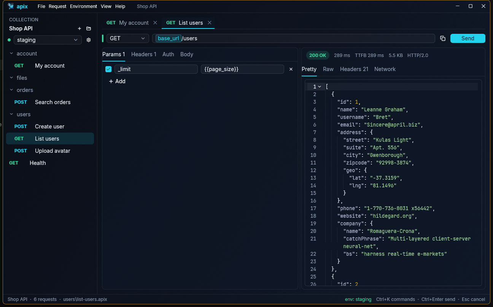

## Contents

- [Opening a collection](#opening-a-collection)
- [The window](#the-window)
- [Sending a request](#sending-a-request)
- [Params and headers](#params-and-headers)
- [Body](#body)
- [Auth](#auth)
- [Request settings](#request-settings)
- [Cookies](#cookies)
- [Variables and environments](#variables-and-environments)
- [The response](#the-response)
- [The Network tab](#the-network-tab)
- [WebSocket and server-sent events](#websocket-and-server-sent-events)
- [Socket.IO](#socketio)
- [gRPC](#grpc)
- [Scripts and tests](#scripts-and-tests)
- [Runner](#runner)
- [Tabs](#tabs)
- [Organising requests](#organising-requests)
- [Projects](#projects)
- [Encrypted collections](#encrypted-collections)
- [Copy as and paste curl](#copy-as-and-paste-curl)
- [Importing from Postman](#importing-from-postman)
- [Importing from Insomnia, OpenAPI and HAR](#importing-from-insomnia-openapi-and-har)
- [History](#history)
- [Command palette](#command-palette)
- [Settings and language](#settings-and-language)
- [Keyboard shortcuts](#keyboard-shortcuts)

## Opening a collection

A **collection** is a folder that holds an `apix.toml` file and your requests
(`.apix` files), optionally in sub-folders. Open one with **File › Open…**
(Ctrl+O), or start a new one with **File › New collection…**. If you pick a
folder that is not a collection yet, Apix offers to make it one.

Recently opened collections are under **File › Open recent**. Starting the app
with a folder (`apix-desktop path/to/collection`) opens it directly.

## The window

- **Sidebar (left):** the collection's folders and requests, read from the
  files on disk and kept up to date when they change. The picker under the
  collection name chooses the active environment.
- **Tabs (top):** every request you open gets a tab.
- **Request pane:** method, URL and the Params, Headers, Auth, Body and
  Settings tabs.
- **Response pane (right):** status, timing, size and the response body.
- **Status bar (bottom):** the collection, the file of the open request and the
  most useful shortcuts.
- **Menu bar:** File, Request, Environment, View and Help hold every command.

## Sending a request

1. Pick the method on the left of the URL bar (or press Alt+1…7 for GET, POST,
   PUT, PATCH, DELETE, HEAD, OPTIONS).
2. Type the URL. `{{variables}}` are allowed anywhere (see
   [Variables](#variables-and-environments)).
3. Press **Send** or Ctrl+Enter. Esc cancels a request that is still running.

While an environment whose name contains “prod” is active, Apix asks before
sending DELETE, PUT or PATCH and shows the full URL it would hit. **Settings ›
Confirm in production** turns that off.

**New request** (Ctrl+N) opens a GET request; the sidebar's **+** menu offers
every method, and POST, PUT and PATCH start with a JSON body. Save with Ctrl+S.
A dot on the tab and in the sidebar marks unsaved changes.

## Params and headers

**Params** are added to the URL's query string, **Headers** are sent as they
are. Untick a row to keep it in the file without sending it. A row without a
key is ignored. `Content-Type` is set from the body type unless you add your
own. `{{variables}}` in keys and values show as chips, as in the URL bar; hover
one to see its value.

## Body

The Body tab offers:

| Type | What is sent |
|---|---|
| None | No body. |
| JSON, Text, XML, HTML | The text as written, with syntax highlighting (`application/json`, `text/plain`, `application/xml`, `text/html` unless a header says otherwise). |
| Form | `application/x-www-form-urlencoded` key–value rows. |
| Multipart | `multipart/form-data`. Each field is **Text** or **File**; the folder button picks one or more files. The type field beside it sets the field's own Content-Type (such as `application/json` or `image/png`); empty lets Apix choose. |
| Binary | The bytes of one file, as `application/octet-stream` unless a header says otherwise. Apix shows the file size, or "File not found". |
| GraphQL | A query editor and a JSON variables editor; sent as `{"query", "variables"}` JSON. |

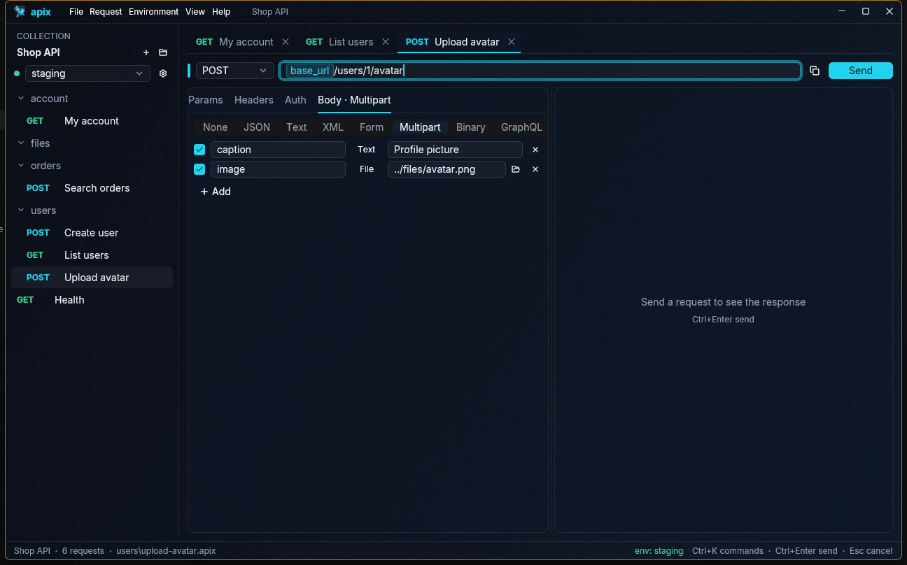

File paths inside the collection are saved relative to the request file, so the
collection keeps working on another machine.

### GraphQL schema and completion

**Fetch schema** above the query asks the server for its schema (the
standard introspection query), with the request's URL, headers, auth and
environment, so a schema behind a token works. Then:

- Typing in the query suggests what fits where the cursor is: the fields of
  the type being selected (with their types), a field's arguments after `(`,
  enum values and `true`/`false` after `:`, the fields of an input object,
  `... on Type` fragments for unions and interfaces, and type names after
  `on` or in `$variable: Type`. Deprecated fields come last. Ctrl+Space
  opens the suggestions without typing.
- Hovering over a field, argument or enum value shows its type and
  description.
- In the variables editor, the variables the query declares
  (`$role: Role`) are suggested as keys, then the fields of input objects,
  enum values (as JSON strings) and `true`/`false` for their values.
- **Show schema** puts the whole schema beside the query, as SDL.

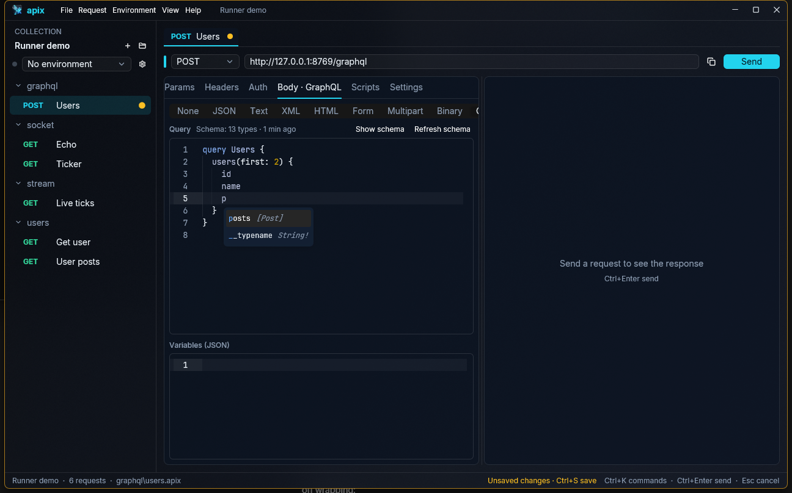

Apix keeps the schema of each endpoint (under the config folder, in
`graphql/`) and loads it again when you open a request to that URL, so
**Refresh schema** is only needed when the API changes. A server with
introspection turned off answers with an error, which is shown in place of
the schema status.

From the command line, `apix schema request.apix` prints the schema as SDL
(`--json` prints the server's answer as it came).

## Auth

The Auth tab sets how the request proves who it is:

| Type | Notes |
|---|---|
| Inherit from parent | The default: use the auth of the nearest folder, collection or project that sets one. The tab tells you what that is and where it comes from. |
| No auth | Send nothing, even if a parent sets auth. |
| Bearer token | `Authorization: Bearer <token>`. |
| Basic auth | Username and password. |
| API key | A header or query parameter of your choice. |
| Digest auth | Apix answers the server's Digest challenge (MD5 or SHA-256). |
| OAuth 1.0 | HMAC-SHA1, HMAC-SHA256 or PLAINTEXT; in the header or the query string; a new nonce and timestamp on every send. |
| OAuth 2.0 | Client credentials, password, or authorization code with PKCE. Apix gets the token itself and sends it as a bearer token. |
| AWS Signature | AWS Signature Version 4 with access key, secret key, optional session token, region and service. |

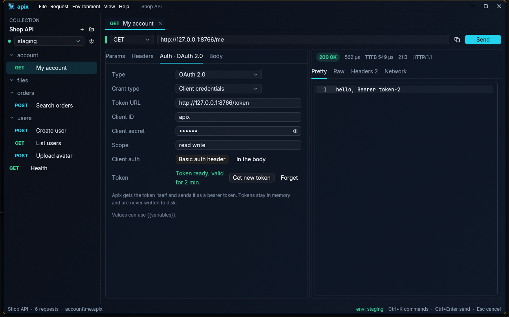

**OAuth 2.0 tokens.** The first send fetches a token; later sends reuse it and
renew it with the refresh token when it expires. **Get new token** fetches one
now, **Forget** drops it. Tokens are kept in memory only and never written to
disk. For the authorization code grant, Apix opens the sign-in page in your
browser and receives the answer on `http://127.0.0.1` (a free port, or the
**Redirect URL** you registered for the client).

**Shared auth.** Right-click a folder or collection and choose **Auth…** to set
auth once for everything inside; **Environment › Project auth…** does the same
for a whole project. Requests whose auth is *Inherit from parent* use it.

## Request settings

The Settings tab controls how the request travels:

| Setting | Default |
|---|---|
| Timeout (seconds) | none — a request runs until it finishes or you cancel it; `0` also means no timeout |
| Follow redirects | on |
| Max redirects | 10 |
| Verify TLS certificate | on — turn it off only for test servers you trust |
| Proxy | from the environment (`HTTP_PROXY`, `HTTPS_PROXY`, `ALL_PROXY`); *Off* ignores those; a URL names one explicitly |
| Client certificate | none — a PEM file, with the key in the same file or a separate one |
| Trusted CA | only the usual root certificates — a PEM file adds certificate authorities of your own (a company or self-signed CA), so the server is still checked |
| Send cookies | on |

Every field left empty (or on *Inherit*) falls back to the nearest folder,
collection or project that sets it, and finally to the defaults above — the
same chain as auth. Right-click a folder or collection and choose **Request
settings…** to set them once for everything inside; **Environment › Project
request settings…** does the same for a whole project. The line under the form
shows what the request ends up using. `{{variables}}` work in the proxy and
certificate fields, and relative certificate paths are resolved against the
file that sets them.

In a request file (and in `folder.toml`, `apix.toml` and `apix-project.toml`)
the settings are a `[settings]` table:

```toml
[settings]
timeout_ms = 5000
tls_verify = false
proxy = ""          # "" = no proxy, even when the environment sets one
client_cert = "certs/client.pem"
ca_cert = "certs/company-ca.pem"
```

**Copy as** writes the matching curl flags (`-m`, `-L --max-redirs`, `-k`,
`-x`, `--cert`, `--key`, `--cacert`) and pasting a curl command with those
flags fills the tab. `apix send` and `apix run` have `--timeout`,
`--insecure`, `--proxy` and `--cacert`, which override the file. These
settings apply to gRPC requests too. Postman's per-request options (`protocolProfileBehavior`) are
imported.

## Cookies

Apix keeps one cookie jar: `Set-Cookie` answers are stored automatically and
sent with later requests to the same site, including across restarts
(`cookies.json` next to the app settings; session cookies die with the app).
**Request › Cookies…** lists them, deletes single cookies, or empties the jar.
The Settings tab's **Send cookies** turns the jar off for a request, a folder,
a collection or a project. The CLI starts with an empty jar on every run.

## Variables and environments

Write `{{name}}` in a URL, header, body or auth field and Apix fills in the
value when sending. In the URL bar each variable is a coloured chip: hover it
to see its value and where it comes from; a red chip is not defined anywhere.

Values come in layers, the later winning:

1. **Project** variables (shared by every collection of a project)
2. **Collection** variables (`apix.toml`)
3. The active **environment** (`environments/<name>.toml`)

Open **Environment › Variables and environments…** (Ctrl+E) to edit them. Tick
**Secret** for tokens and passwords: secret values are stored in
`environments/<name>.local.toml`, which Apix adds to `.gitignore`, so they are
never committed.

To keep them off the disk too, choose **Settings › Environment secrets ›
System keychain**. The values then go to the system's credential store
(Credential Manager on Windows, the Keychain on macOS, the Secret Service on
Linux) and `<name>.local.toml` only keeps the id of that entry, so renaming the
environment or moving the folder keeps working. The `apix` command line reads
them the same way. Changing the setting moves the secrets of the open collection
or project at once; others move the next time you save them. Secrets of an
encrypted collection always stay inside it.

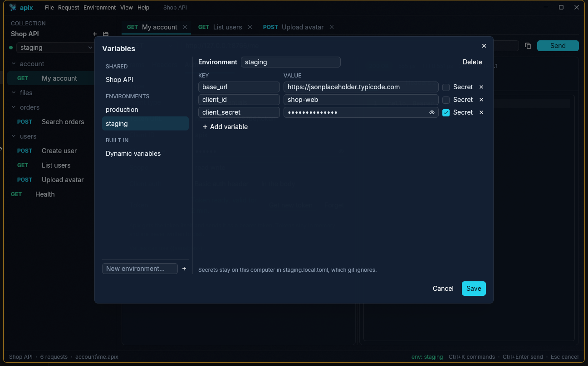

**Dynamic variables** get a fresh value on every use: `{{$guid}}`,
`{{$timestamp}}`, `{{$isoTimestamp}}`, `{{$randomInt}}`, `{{$randomEmail}}` and
more; the **Dynamic variables** page of the Variables dialog lists them all with a sample value.

## The response

The response pane shows the status, the time to the first byte and in total,
and the size. **Pretty** formats JSON (fold blocks with the arrows) and
indents and colours XML and HTML; **Raw** shows the body as received,
**Headers** lists the response headers and **Hex** shows the bytes. Very large
bodies (tens of megabytes) open in a fast viewer that only draws the visible
lines.

Apix tells the body's kind from its `Content-Type`, or from the bytes when the
type says nothing useful. Images (PNG, JPEG, GIF, WebP, BMP, SVG) are shown
in **Pretty**; other binary content (a PDF, a zip…) gets a short summary
instead of unreadable text. HTML that leaves out optional closing tags is shown
as it came rather than reformatted.

The **↓** button at the end of the status line saves the body, byte for byte,
to a file. The suggested name comes from the server's `Content-Disposition`
or from the URL, with an extension that fits the content.

## The Network tab

The **Network** tab explains where the time went and what the connection was:

- a timing bar split into DNS, connecting, waiting and downloading
- the DNS answers, the server and local address, the network interface (with a
  hint when a VPN is in use), the gateway, DNS servers and proxy
- every redirect
- the server certificate: issuer, validity and days left

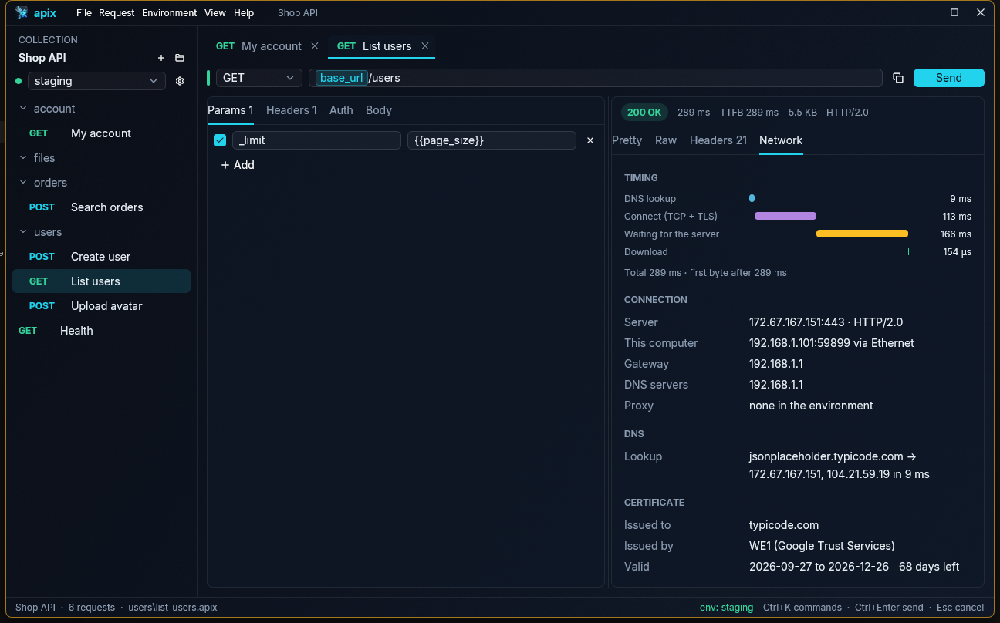

## WebSocket and server-sent events

**WebSocket.** A request whose URL starts with `ws://` or `wss://` is a
WebSocket: **Send** becomes **Connect**, and the Body tab becomes
**Messages**. The handshake uses the request's params, headers and auth
(Bearer, Basic, API key, OAuth 2.0 …), like any request.

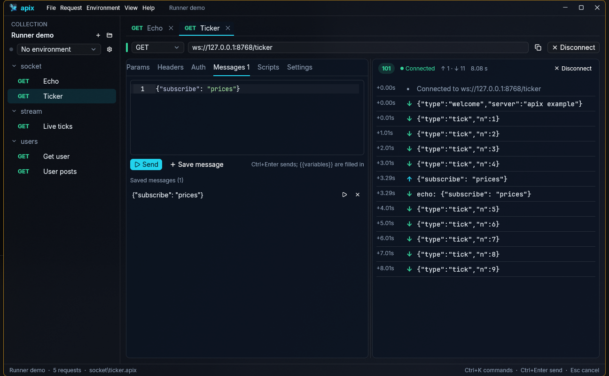

- Type a message and press **Send** (or Ctrl+Enter). `{{variables}}` are
  filled in when it is sent. Without a connection, Apix connects first and
  sends it once open.
- **Save message** keeps it in the request file as `[[message]]`; Ctrl+S
  saves the file. Click a saved message to edit it, or ▷ to send it as it is.
- The response pane is a log: ↑ sent, ↓ received, with the time since
  connecting, plus when it connected and how it closed (code and reason).
  It follows new messages unless you scroll up.
- **Disconnect** (or Esc) closes the connection; the log stays until you
  connect again. A connection keeps running while its tab is in the back.
- **Binary messages:** pick **Base64** or **Hex** beside the buttons and
  write the bytes that way (`01 02 ff`, spaces and `0x` allowed); a message
  that does not read as bytes cannot be sent. Saved messages keep their
  format. Binary messages show in the log as their size and first bytes.
- **Subprotocols** (top of the Messages tab, comma-separated) are offered in
  the handshake; the log names the one the server picked. A server that
  picks none of them is refused, as browsers do.
- `wss://` follows the request settings: a trusted CA, a client certificate,
  or "Verify TLS certificate" turned off.

**Server-sent events.** When a response is `text/event-stream`, its events
show up as they arrive, with the time, the event type and id, and the data.
**Stop** (or Esc) ends the stream and keeps what came; a stream the server
ends shows the same list on the Pretty tab, with Raw, Headers, Network and
Hex as for any response. Send `Accept: text/event-stream` if the server
needs it. A request timeout in Settings ends a stream too, so leave it empty
for streams that stay open.

- With more than one event type, the types appear above the list with how
  many came of each; click one to show only those, **All** for every event.
- **Reconnect** (in the live view) picks the stream up again when it ends or
  the connection drops: after the server's `retry:` time (3 s when it gave
  none), with `Last-Event-ID` set to the last id seen, as a browser does.
  The list notes each reconnection. An answer that is not an event stream
  stops it, and so does Esc.

From the command line, `apix send` prints events as they come (`--event
TYPE`, repeatable, prints only those; `--reconnect` keeps reconnecting until
Ctrl+C). For a WebSocket it connects, sends the saved messages (or
`--message` texts, read as `--format text|base64|hex`), prints both
directions and closes after `--listen` seconds (3 by default, `0` waits for
the server). `apix run` skips WebSocket requests.

## Socket.IO

A Socket.IO request talks to servers of Socket.IO 3 and 4 over WebSocket.
Open a request's **Messages** tab (give it a `ws://` URL for the tab to
show) and pick **Socket.IO** at the top; the URL may then be `http://`,
`https://`, `ws://` or `wss://`, as in a Socket.IO client. The request file
gets a `[socketio]` table, and a Socket.IO request opens on its Messages tab.

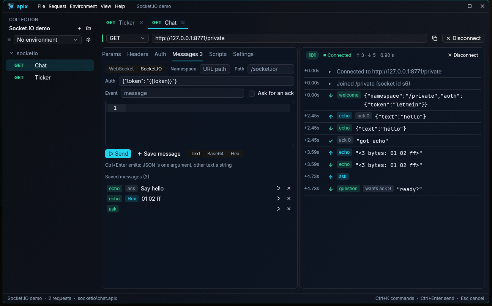

- **Namespace:** the one to join, like `/chat`. Left empty, it is the URL's
  path (`http://localhost:3000/chat` joins `/chat`), or `/`. **Path** is where
  the server listens, `/socket.io/` unless the server moved it. An address
  copied from the browser's network tab
  (`…/socket.io/?EIO=4&transport=websocket`) works as it is.
- **Auth:** a JSON object sent when joining (the client's `auth` option),
  with `{{variables}}` filled in. When the server refuses, the reason it gave
  is shown as the error.
- **Event** names what a message is emitted as (`message` when empty).
  The text is one argument: JSON as it is, any other text as a string, and
  nothing at all when it is empty. **Base64** and **Hex** send the bytes as
  a binary attachment. **Ask for an ack** asks the server to acknowledge.
  Saved messages keep their event and ack.
- The log shows each event with its name: ↑ emitted (with `ack 0`, `ack 1`
  … when an ack was asked), ↓ received (with `wants ack 9` when the server
  asks for one), and ✓ for the server's acks with what it answered. Binary
  attachments show as their size and first bytes. The handshake headers,
  params and auth and the TLS settings work as for a WebSocket.
- Apix answers the server's pings. When the server makes the client leave
  the namespace, the log says so and the connection closes; **Disconnect**
  (or Esc) leaves the namespace and closes.

`apix send` joins, emits the saved messages and prints the events, acks and
binary attachments as they come; `--message TEXT` (repeatable) emits texts
instead, as the event `--event NAME` gives (`message` by default).
`apix run` skips Socket.IO requests. Received attachments are written as
`{"$binary": "<base64>"}`. Not yet: Socket.IO 2 servers (Engine.IO 3), the
long-polling transport, and answering an ack the server asks for.

## gRPC

A request whose URL starts with `grpc://` (or `grpcs://` for TLS) calls a
gRPC method: the URL bar shows **gRPC**, and the Body tab becomes
**Message**.

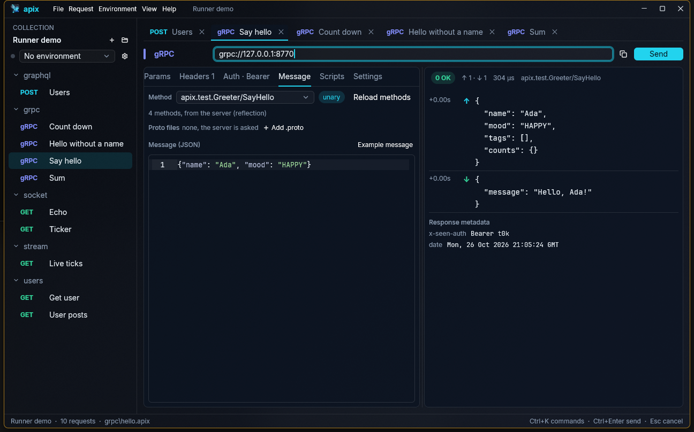

1. Write the address, such as `grpc://localhost:50051`.
2. **Load methods** asks the server what it offers (gRPC server reflection).
   If the server has no reflection, **Add .proto** picks the service's
   `.proto` files; imports are looked up next to them, and Google's
   well-known types are built in. Nothing needs `protoc`.
3. Pick the method. Its kind is shown beside it: unary, server streaming,
   client streaming or bidirectional.
4. Write the message as JSON, or press **Example message** for one with every
   field. For a method that takes a stream, a JSON list sends one message
   per item.
5. **Send** (Ctrl+Enter). The response pane lists what went out (↑) and what
   came back (↓) with times, then the status (`0 OK`, or a code such as
   `5 NOT_FOUND` with its message), the response metadata and the trailers.
   A stream shows its messages as they arrive; Esc stops it.

Headers are sent as metadata, and Auth works as for HTTP with Bearer, Basic,
an API key in a header and OAuth 2.0. The request settings' timeout, client
certificate, trusted CA and "Verify TLS certificate" apply (turned off, a
`grpcs://` server's certificate is not checked). A `-bin` header is read as
base64.

From the command line, `apix send` calls the method (streams are printed one
message per line as they come; the exit code is non-zero unless the status is
OK), and `apix schema` prints the service and its messages.

**In runs and tests.** `apix run` and the Runner call gRPC requests too, and
their test scripts and checks see the call as an HTTP response: the status is
the HTTP status the gRPC code stands for (`OK` is 200, `INVALID_ARGUMENT` 400,
`NOT_FOUND` 404, `UNAUTHENTICATED` 401, …), the gRPC code and message are in
the `grpc-status` and `grpc-message` headers next to the metadata and
trailers, and the body is the answer, or a JSON list of the messages for a
method that answers with a stream. So `pm.response.json().message` or a check
on `body.message` works as for any request. A single **Send** shows the call
without running its scripts.

Every call is kept in the **History** (Ctrl+H) with its log, status and
metadata; picking it shows the call again as it ended.

## Scripts and tests

The **Scripts** tab holds two JavaScript scripts for the request:

- **Pre-request** runs before the request is sent. It can change the request
  (`pm.request.headers.upsert(…)`, `pm.request.url.query.add(…)`,
  `pm.request.body.raw = …`) and set variables
  (`pm.environment.set("token", …)`).
- **Tests** runs after the response arrives and checks it:

```js
pm.test("status is 200", () => pm.response.to.have.status(200));
pm.test("has users", () => {
  const body = pm.response.json();
  pm.expect(body.users).to.be.an("array").that.is.not.empty;
});
```

The API is Postman's `pm.*` (also available as `apix.*`), so scripts imported
from Postman run as they are: `pm.environment`, `pm.collectionVariables`,
`pm.globals` (the project's variables), `pm.variables`, `pm.request`,
`pm.response`, `pm.test`, `pm.expect` with Chai-style assertions,
`pm.info`, `console.log`, and the older `tests["…"] = …` and
`postman.setEnvironmentVariable(…)`.

`pm.sendRequest` sends another request from a script, for example to get a
token first; both `pm.sendRequest(req, (err, res) => …)` and
`const res = await pm.sendRequest(req)` work. `require(…)` offers the parts of
`crypto-js` (MD5, SHA-1, SHA-2 and their HMACs, Base64/Hex/UTF-8 encoders),
`uuid`, `lodash` (also `_`), `moment`, `ajv`, `tv4` and `chai` that API
scripts use; they are built in, so nothing is downloaded. A function a
library does not have fails with a clear message.

The third part of the Scripts tab, **Checks**, tests the response without
code: each row compares a target with a value. Targets are `status`, `time`
(ms), `size` (bytes), `body`, a path in a JSON body such as
`body.users[0].id`, or `header.Content-Type`; comparisons are `==`, `!=`,
`>`, `>=`, `<`, `<=`, `contains`, `not contains`, `exists`, `not exists`,
`matches` (a regular expression such as `/^ok/i`) and `is` (a JSON type).
Values may use `{{variables}}`. Checks are saved in the request file as
`[[assert]]` and show up as tests, in the app and in `apix run`.

To keep a value from a response, use the **{x}** button next to the status:
give the value (same targets as in Checks) and a variable name, and it is
saved in the active environment (or, with none, the collection's variables).
Tick **Update it on every send** to also add the matching
`pm.environment.set(…)` line to the Tests script.

Scripts are files next to what they belong to: `<request>.prerequest.js` and
`<request>.test.js` next to the request, `_folder.prerequest.js` /
`_folder.test.js` in a folder, `_collection.prerequest.js` /
`_collection.test.js` in the collection root. They run from the outside in:
collection, folders, then the request. Ctrl+S saves the request's scripts with
it; the editor's text is used even before you save.

After sending, the response pane gets a **Tests** tab (✓ passed, ✗ failed with
the reason) and a **Console** tab with `console.*` output. If a pre-request
script throws, the request is not sent and the error says which file failed.
Scripts stop after 10 seconds.

Values a script sets are not written to any file. They last while Apix is open
(switching environment drops what `pm.environment.set` set) and show up in the
variable cards as “Set by a script”. `pm.variables.set` lasts for one send.

## Runner

The **Runner** sends many requests in one go and checks them all. Open it with
**View › Runner…** or Ctrl+Shift+R for the collection you are in, or with
**Run…** on a collection or folder in the sidebar for just that part.

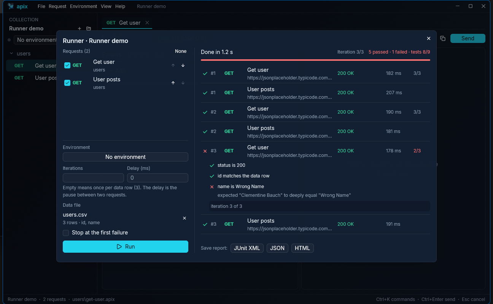

- **Requests**: every request in sidebar order, ticked. Untick the ones to
  leave out, and move one with ↑ ↓ to change the order for this run.
- **Environment**: which environment's variables to use.
- **Iterations**: how many times to go through the requests. Left empty, it is
  once, or once per row when there is a data file.
- **Delay (ms)**: a pause between two requests, for rate-limited APIs.
- **Data file**: a CSV or JSON file for a data-driven run. Every row is one
  iteration and its columns are variables: `{{email}}` in the request and
  `pm.iterationData.get("email")` in scripts. CSV needs a header line; quotes
  and semicolon-separated files (Excel in many languages) are understood. JSON
  is an array of objects, like `[{"id": 1, "email": "a@x.test"}, …]`.
- **Stop at the first failure**: end the run at the first request that fails.

A request passes when its tests (scripts and Checks) pass; a request without
tests passes on a 2xx or 3xx status. While it runs you can **Pause**,
**Resume** and **Stop** (after the request being sent). Closing the dialog
does not stop the run: open the Runner again to see it. Click a result to see
its tests, why it was not sent, and its console lines. `pm.execution
.setNextRequest("name")` jumps to another request of the run and
`setNextRequest(null)` ends the iteration, as in Postman.

The Runner sends the saved version of each request. Values scripts set before
the run are used; what the run's scripts set stays inside the run.

When the run is over, **Save report** writes it as **JUnit XML** (for CI
test views), **JSON** (everything that happened) or **HTML** (a page that
opens in any browser, light or dark). `apix run` does the same from a
terminal; see [Run a collection in CI](workflows.md#run-a-collection-in-ci).

## Tabs

Each tab keeps its unsaved edits, its last response, and even a request that is
still running. Ctrl+Tab and Ctrl+Shift+Tab move between tabs, Ctrl+W or a
middle click closes one; Apix asks before closing unsaved changes. The tabs
that were open come back the next time you open the same collection or
project (tabs of encrypted collections are not remembered, as their file names
are secret too).

## Organising requests

Right-click in the sidebar to create, rename, duplicate or delete requests and
folders; deleted files go to the system trash. Drag a request or folder onto
the middle of another folder to move it there. Drop it on the top or bottom
edge of a row instead to put it before or after that row; a line shows where
it will land. The order is saved in `apix.toml` (for the collection's top
level) and `folder.toml` (for a folder) as an `order` list, so it is shared
through git; items it does not list follow by name. Postman imports keep
Postman's order, and exports to Postman follow yours.

## Projects

A **project** groups several collections that belong together and shares
environments and auth between them. Create one with **File › New project…**.
In a project, **Environment › Group the sidebar by** can show the sidebar as
Project › Environment › Collections.

- Drag a collection's header above or below another one to change their order.
- Right-click a collection › **Colour** gives it a colour; a dot shows it in the
  sidebar and on the tabs of its requests. Colours are saved in
  `apix-project.toml`.
- **File › Move into a project…** (with a single collection open) moves that
  collection's folder into a project you pick. With a project open, dropping a
  collection's folder from the file manager onto the window offers the same.

## Encrypted collections

An encrypted collection keeps every request, environment and even file name
sealed on disk (XChaCha20-Poly1305 with an Argon2id password key). Git only sees
which encrypted blob changed.

- **File › Encrypt this collection…** or right-click a collection › **Encrypt…**
  encrypts an existing collection in place.
- **File › New encrypted collection…** creates one inside a project.
- You get a **recovery key** once. Keep it somewhere safe: it opens the
  collection if the password is lost.
- Opening the collection asks for the password. It locks again when you choose
  **File › Lock encrypted collections**, quit Apix, or leave it idle for the
  time set in Settings (15 minutes by default).
- Tick **Remember on this computer** in the unlock prompt to keep the password
  in the system's credential store (Credential Manager on Windows, the Keychain
  on macOS, the Secret Service on Linux). The collection then opens without
  asking while you are signed in, and the `apix` command line uses the saved
  password too. **File › Forget saved password** (or right-click the
  collection) removes it. If the password was changed elsewhere, the saved one
  is dropped and Apix asks again.

## Copy as and paste curl

The copy button next to **Send** (or **Request › Copy as**) copies the request
as `curl` for bash or fish, `curl.exe` for the Windows command prompt, a
PowerShell `Invoke-RestMethod` call, an HTTPie `http` command (HTTPie 3.0 or
later) or a GNU `wget` command, with variables filled in. wget cannot send
multipart forms; the copied command says so. Requests signed per send
(OAuth 1.0, AWS for PowerShell and code) are signed at the moment you copy.

The same menu copies the request as a program: JavaScript `fetch`, Node.js
axios, Python requests, Go `net/http`, Rust reqwest, C# `HttpClient`, Java
`HttpClient`, PHP cURL, Swift `URLSession` or Kotlin OkHttp. Each one sends
what Apix would send — URL, headers, auth and every body type — and the
request settings the language can express (timeout, redirects, TLS check,
proxy, client certificate). A setting a language has no simple switch for is
listed in a `Not in this snippet` comment at the top instead of being dropped
silently. In the sidebar, right-click a request and use **Copy as code**.

The CLI writes the same: `apix code request.apix --as python` (`apix shell` is
the same command; `--as` takes `bash`, `cmd`, `powershell`, `fetch`, `axios`,
`python`, `go`, `rust`, `csharp`, `java`, `php`, `swift` or `kotlin`).

Paste a `curl` command (for example from your browser's "Copy as cURL") into the
URL field and Apix fills in the whole request: method, URL, query, headers,
auth and body.

## Importing from Postman

**File › Import…**, or drop a Postman export onto the window.
Collections (v2.0 and v2.1) and environments are supported. Folders, requests,
bodies, auth and variables are carried over; anything Apix cannot take over yet
is listed in a report. Pre-request and test scripts are kept as `.js` files next
to their requests, and environment secrets go to the gitignored `.local.toml`.

**Many files at once.** Open or drop a folder that holds Postman exports — or
the zip that Postman's *Export data* produces — and Apix recognises the files
by their content, not their names, and offers to import everything as one
project: a collection per Postman collection, the environments shared by all
of them, and globals as project variables (secret globals are left out, since
project variables are committed). Two environments with the same name are kept
as `name` and `name-2`.

**Export to Postman.** Right-click a collection and choose **Export to
Postman…** (or **File › Export to Postman…**) to write a Postman v2.1
collection file and one environment file per environment, so teammates on
Postman can keep working with it. Folders, auth, bodies, scripts, variables and
the redirect, TLS and cookie settings carry over. Postman has no per-request
timeout, proxy or client certificate, and secret environment values are
exported with their names only; the notification lists what was left out.

On the command line: `apix import <file, folder or zip>` and
`apix export <collection> --out <folder>`.

## Importing from Insomnia, OpenAPI and HAR

**File › Import…** (or dropping the file on the window) also reads these; the
format is recognised by content, and a folder or zip may mix them:

| Format | What you get |
|---|---|
| Insomnia v4 (JSON export) | A collection per workspace, folders with their auth, the base environment as collection variables and every sub-environment as an environment. `{{ _.name }}` becomes `{{name}}`. |
| OpenAPI 3 / Swagger 2 (JSON or YAML) | A request per operation, a folder per tag. The server becomes the `baseUrl` variable (several servers: an environment each), path parameters become variables with their example values, required query and header parameters are switched on, bodies come from examples or are built from the schema, and security schemes become auth with empty credential variables (`bearerToken`, `apiKey`, …) to fill in an environment. |
| HAR (browser DevTools "Save all as HAR") | API calls only, a folder per host. Scripts, styles, images and fonts, `data:` URLs and repeats are left out, and so are `Cookie` headers: they carry the browser's session. |

One collection from one file is imported as a collection; several become a
project. The report lists everything that could not be carried over.

## History

Every request you send is kept with its response. **View › History…**
(Ctrl+H) lists them, newest first, with method, name, URL, status and when it
was sent; type to search by any of these. Pick an entry and the request comes
back in the tab it was sent from, as unsaved edits, together with the response
it got. Press Ctrl+Enter to send it again, Ctrl+S to keep that version. If the
request file is gone, the entry opens in the editor without a tab.

History stays on this computer (the `history` folder next to the settings),
never inside a collection. Requests are stored as written, with `{{variables}}`
unresolved, so environment secrets are not copied into it. The last 300
requests are kept, response bodies up to 256 KB each. Requests from encrypted
collections are never written to the history. **Clear history** in the window
empties it; **File › Settings… › History** turns it off.

## Command palette

Ctrl+K (or Ctrl+P) opens the command palette: type a few letters of a request
name or a command and press Enter. Commands can be found by their English names
in every language.

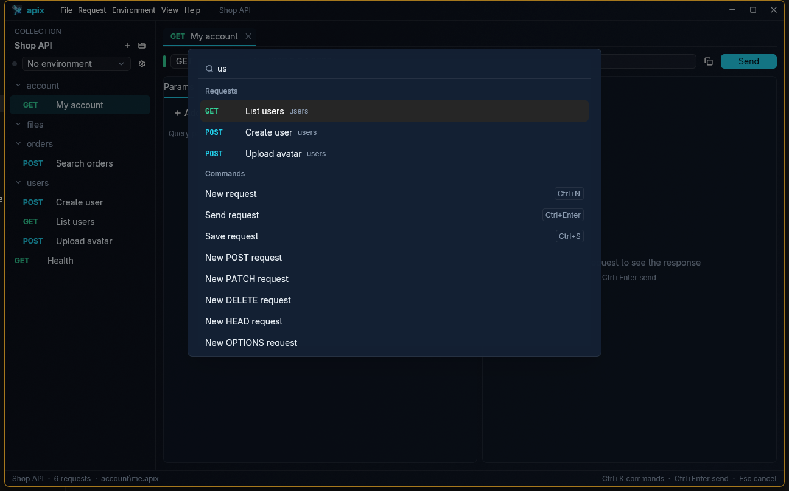

## Settings and language

**File › Settings…** (Ctrl+,):

- **Language:** English, Türkçe, العربية, Deutsch, Français, Русский, 日本語,
  简体中文 or Español. The change applies at once. On first start Apix follows
  the system language. In Arabic the window mirrors: the sidebar is on the
  right and menus, tabs and forms run from the right, while URLs, code and
  key–value tables stay left to right.
- **Lock encrypted collections:** after 5, 15 or 30 minutes, 1 hour, or never.
- **Environment secrets:** in a `.local.toml` file or in the system keychain
  (see [Variables and environments](#variables-and-environments)).
- **Confirm in production:** ask before DELETE, PUT or PATCH while a “prod”
  environment is active (on by default).
- **History:** on or off (see [History](#history)).

The **Theme** part of Settings changes how Apix looks, at once, without a
restart:

- **Appearance:** dark, light, or **Follow the system**, which switches when
  Windows or macOS switches between light and dark mode.
- **Dark theme:** Obsidian (the default), Cyber glass, Dracula, Nord or
  Solarized Dark. **Light theme:** Daylight or Solarized Light. Picking a
  theme of the other kind switches the appearance to it.
- **Accent colour:** the theme's own, or cyan, blue, purple, pink, red,
  orange, yellow or green, for buttons, selections, focus rings and the
  variable chips. Light themes get a deeper shade, and the text on the accent
  is dark or white, whichever reads better.
- **Transparency:** a slider from 0 (a solid window) to 90%: how much of the
  desktop shows through, blurred like frosted glass (acrylic on Windows,
  vibrancy on macOS). The window background clears with it, panels at a
  slower rate so text keeps a backing, and borders brighten like the edge of
  glass; menus and dialogs stay solid. Light themes clear more gently, as dark
  text needs a light backing. The default is 20%.
- **Your own themes:** **Open the folder** opens `<config>/Apix/themes` and,
  the first time, writes `my-theme.toml` there to start from. Every `.toml`
  file in that folder is a theme in the lists; a file named like a built-in
  theme (`nord.toml`) replaces it. A file that cannot be read is named in red
  with the reason.

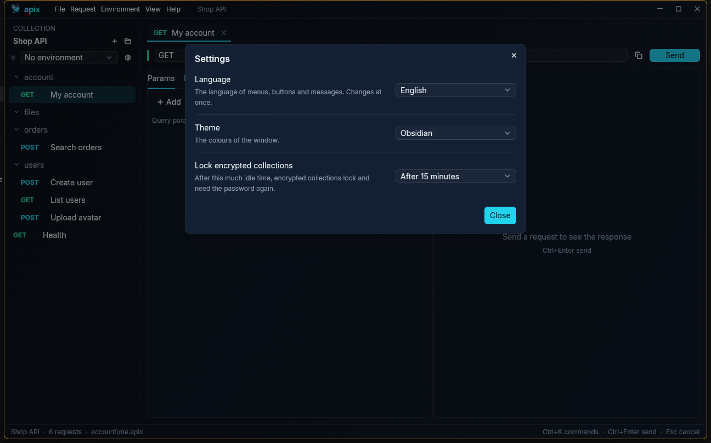

A theme file sets a name, whether it is light, and any of these colours
(`#RRGGBB`, or `#RRGGBBAA` with opacity); the ones it leaves out come from
Obsidian, or from Daylight for a light theme:

```toml
name = "Deep sea"
light = false

[colors]
background = "#03141FEE"      # the window, a gradient to background_end
background_end = "#062A3AEE"
surface = "#05202DB3"         # panels
raised = "#0A2B3BF7"          # menus and dialogs
border = "#FFFFFF14"
accent = "#FF9F43"
text = "#E8F6FF"
muted = "#7FA3B8"
ok = "#34D399"                # 2xx, passed tests
warning = "#FBBF24"
error = "#F87171"
string = "#86EFAC"            # JSON in the large-body viewer
number = "#FDBA74"
keyword = "#C4B5FD"
```

Theme files are plain text, so a team can share them; Apix reads them when it
starts and when Settings opens.

Settings are saved in `settings.toml` in the Apix folder of your system's
configuration directory (`%APPDATA%\Apix` on Windows,
`~/Library/Application Support/Apix` on macOS, `~/.config/Apix` on Linux).

## Keyboard shortcuts

| Keys | Action |
|---|---|
| Ctrl+Enter | Send |
| Esc | Cancel the request |
| Ctrl+S | Save |
| Ctrl+N | New GET request |
| Ctrl+O | Open a folder, project or collection |
| Ctrl+K or Ctrl+P | Command palette |
| Ctrl+E | Variables and environments |
| Ctrl+, | Settings |
| Ctrl+H | History |
| Ctrl+Shift+R | Runner |
| Alt+1…7 | Switch the method |
| Ctrl+W | Close the tab |
| Ctrl+Tab / Ctrl+Shift+Tab | Next / previous tab |
| Ctrl+Space | Suggestions in the GraphQL query (after fetching the schema) |

On macOS, use ⌘ instead of Ctrl (Ctrl+Tab and Ctrl+Space stay Ctrl).
