<!-- translated from en/user-guide.md sha256:370b0c3e16a4c70f -->

# Apix kullanım kılavuzu

Apix bir masaüstü API istemcisidir: HTTP istekleri oluşturur, gönderir ve
yanıtları okursunuz. İstekler bir klasörde küçük metin dosyaları olarak
kaydedilir; böylece bir koleksiyon kodunuzla birlikte git'te durabilir. Bu
kılavuz uygulamayı bölüm bölüm tanıtır; [iş akışları](workflows.md) sık yapılan
işleri adım adım anlatır, `apix` komut satırı ise aynı istekleri bir terminalde
veya CI'da çalıştırır.

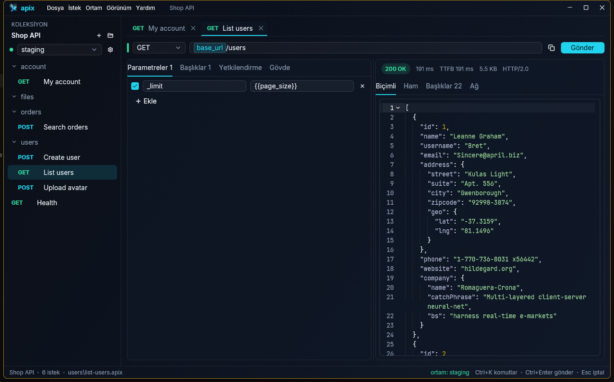

## İçindekiler

- [Koleksiyon açma](#koleksiyon-açma)
- [Pencere](#pencere)
- [Bir istek gönderme](#bir-istek-gönderme)
- [Parametreler ve başlıklar](#parametreler-ve-başlıklar)
- [Gövde](#gövde)
- [Yetkilendirme](#yetkilendirme)
- [İstek ayarları](#istek-ayarları)
- [Çerezler](#çerezler)
- [Değişkenler ve ortamlar](#değişkenler-ve-ortamlar)
- [Yanıt](#yanıt)
- [Ağ sekmesi](#ağ-sekmesi)
- [WebSocket ve sunucu olayları (SSE)](#websocket-ve-sunucu-olayları-sse)
- [gRPC](#grpc)
- [Scriptler ve testler](#scriptler-ve-testler)
- [Runner](#runner)
- [Sekmeler](#sekmeler)
- [Kenar çubuğunda istekleri düzenleme](#kenar-çubuğunda-istekleri-düzenleme)
- [Projeler](#projeler)
- [Şifreli koleksiyonlar](#şifreli-koleksiyonlar)
- [Komut olarak kopyala ve curl yapıştırma](#komut-olarak-kopyala-ve-curl-yapıştırma)
- [Postman'dan içe aktarma](#postmandan-içe-aktarma)
- [Insomnia, OpenAPI ve HAR'dan içe aktarma](#insomnia-openapi-ve-hardan-içe-aktarma)
- [Geçmiş](#geçmiş)
- [Komut paleti](#komut-paleti)
- [Ayarlar ve dil](#ayarlar-ve-dil)
- [Klavye kısayolları](#klavye-kısayolları)

## Koleksiyon açma

**Koleksiyon**, bir `apix.toml` dosyası ile isteklerinizi (`.apix` dosyaları)
barındıran, isteğe bağlı olarak alt klasörler de içerebilen bir klasördür. Bir
koleksiyonu **Dosya › Aç…** (Ctrl+O) ile açın ya da **Dosya › Yeni koleksiyon…**
ile yeni bir tane başlatın. Henüz koleksiyon olmayan bir klasör seçerseniz Apix
onu koleksiyona dönüştürmeyi önerir.

Son açılan koleksiyonlar **Dosya › Son açılanlar** altındadır. Uygulamayı bir
klasörle başlatmak (`apix-desktop path/to/collection`) o klasörü doğrudan açar.

## Pencere

- **Kenar çubuğu (sol):** koleksiyonun klasörleri ve istekleri; diskteki
  dosyalardan okunur ve dosyalar değiştikçe güncel tutulur. Koleksiyon adının
  altındaki seçici etkin ortamı belirler.
- **Sekmeler (üst):** açtığınız her istek bir sekme alır.
- **İstek bölmesi:** metot, URL ve Parametreler, Başlıklar, Yetkilendirme,
  Gövde ve Ayarlar sekmeleri.
- **Yanıt bölmesi (sağ):** durum, süre, boyut ve yanıt gövdesi.
- **Durum çubuğu (alt):** koleksiyon, açık isteğin dosyası ve en kullanışlı
  kısayollar.
- **Menü çubuğu:** Dosya, İstek, Ortam, Görünüm ve Yardım menüleri tüm
  komutları içerir.

## Bir istek gönderme

1. URL çubuğunun solundan metodu seçin (ya da GET, POST, PUT, PATCH, DELETE,
   HEAD, OPTIONS için Alt+1…7 tuşlarına basın).
2. URL'yi yazın. `{{variables}}` her yerde kullanılabilir (bkz.
   [Değişkenler](#değişkenler-ve-ortamlar)).
3. **Gönder**'e basın veya Ctrl+Enter kullanın. Esc, hâlâ çalışan bir isteği
   iptal eder.

Adında “prod” geçen bir ortam seçiliyken Apix, DELETE, PUT veya PATCH
göndermeden önce sorar ve gideceği tam URL'yi gösterir. **Ayarlar › Üretimde
onay iste** bunu kapatır.

**Yeni istek** (Ctrl+N) bir GET isteği açar; kenar çubuğundaki **+** menüsü tüm
metotları sunar, POST, PUT ve PATCH ise JSON gövdesiyle başlar. Ctrl+S ile
kaydedin. Sekmedeki ve kenar çubuğundaki nokta kaydedilmemiş değişiklikleri
gösterir.

## Parametreler ve başlıklar

**Parametreler** URL'nin sorgu dizesine eklenir, **Başlıklar** olduğu gibi
gönderilir. Bir satırı dosyada tutup göndermemek için işaretini kaldırın.
Anahtarı olmayan satırlar yok sayılır. Kendiniz bir tane eklemediğiniz sürece
`Content-Type` gövde türünden belirlenir. Anahtar ve değerlerdeki
`{{değişkenler}}` URL çubuğundaki gibi çip olarak görünür; değerini görmek için
üzerine gelin.

## Gövde

Gövde sekmesi şunları sunar:

| Tür | Gönderilen |
|---|---|
| Yok | Gövde yok. |
| JSON, Metin, XML, HTML | Metin, yazıldığı gibi; söz dizimi vurgulamasıyla (bir başlık aksini belirtmedikçe `application/json`, `text/plain`, `application/xml`, `text/html`). |
| Form | `application/x-www-form-urlencoded` anahtar–değer satırları. |
| Multipart | `multipart/form-data`. Her alan **Metin** veya **Dosya** olur; klasör düğmesi bir veya birden fazla dosya seçer. |
| İkili | Tek bir dosyanın baytları; bir başlık aksini belirtmedikçe `application/octet-stream` olarak. Apix dosya boyutunu ya da “Dosya bulunamadı” uyarısını gösterir. |
| GraphQL | Bir sorgu düzenleyicisi ve bir JSON değişken düzenleyicisi; `{"query", "variables"}` JSON'u olarak gönderilir. |

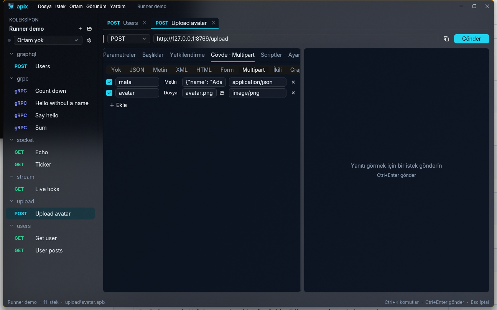

Koleksiyon içindeki dosya yolları istek dosyasına göre göreli kaydedilir;
böylece koleksiyon başka bir makinede de çalışmaya devam eder.

### GraphQL şeması ve otomatik tamamlama

Sorgunun üstündeki **Şemayı getir**, sunucudan şemasını ister (standart
introspection sorgusu); bunu isteğin adresi, başlıkları, yetkilendirmesi ve
ortamıyla yapar, yani token arkasındaki bir şema da gelir. Sonra:

- Sorguya yazarken imlecin olduğu yere uyanlar önerilir: seçilen türün
  alanları (türleriyle), `(` sonrasında alanın argümanları, `:` sonrasında
  enum değerleri ve `true`/`false`, girdi nesnelerinin alanları, birleşim ve
  arayüzler için `... on Tür` parçaları, `on` sonrasında ya da
  `$değişken: Tür` içinde tür adları. Kullanımdan kalkmış alanlar en sonda
  gelir. Ctrl+Space önerileri yazmadan açar.
- Bir alanın, argümanın ya da enum değerinin üzerine gelince türü ve
  açıklaması görünür.
- **Şemayı göster** tüm şemayı SDL olarak sorgunun yanına koyar.

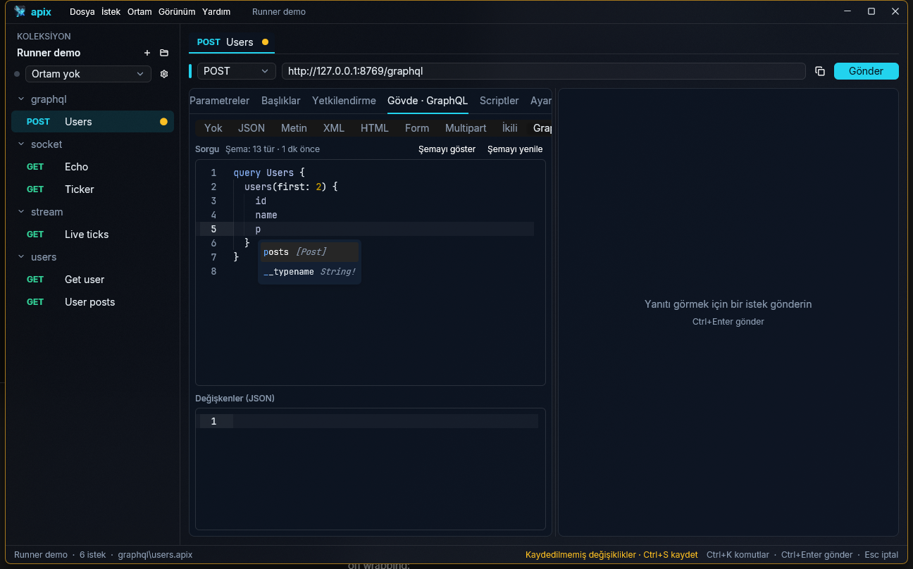

Apix her uç noktanın şemasını saklar (ayar klasöründe, `graphql/` altında)
ve o adrese giden bir isteği açınca yeniden yükler; **Şemayı yenile** yalnızca
API değişince gerekir. Introspection'ı kapalı bir sunucu hata döner; hata,
şema durumunun yerinde gösterilir.

Komut satırında `apix schema istek.apix` şemayı SDL olarak yazar (`--json`
sunucunun cevabını geldiği gibi yazar).

## Yetkilendirme

Yetkilendirme sekmesi, isteğin kimliğini nasıl kanıtlayacağını belirler:

| Tür | Notlar |
|---|---|
| Üst öğeden devral | Varsayılan: yetkilendirme ayarlayan en yakın klasörün, koleksiyonun veya projenin yetkilendirmesini kullanır. Sekme bunun ne olduğunu ve nereden geldiğini gösterir. |
| Yetkilendirme yok | Bir üst öğe yetkilendirme ayarlasa bile hiçbir şey gönderilmez. |
| Bearer token | `Authorization: Bearer <token>`. |
| Basic auth | Kullanıcı adı ve parola. |
| API anahtarı | Seçtiğiniz bir başlık veya sorgu parametresi. |
| Digest auth | Apix, sunucunun Digest sınamasını (MD5 veya SHA-256) yanıtlar. |
| OAuth 1.0 | HMAC-SHA1, HMAC-SHA256 veya PLAINTEXT; başlıkta veya sorgu dizesinde; her gönderimde yeni bir nonce ve zaman damgası. |
| OAuth 2.0 | İstemci kimlik bilgileri, parola veya PKCE ile yetkilendirme kodu. Apix token'ı kendisi alır ve bearer token olarak gönderir. |
| AWS Signature | Erişim anahtarı, gizli anahtar, isteğe bağlı oturum token'ı, bölge ve servis ile AWS Signature Version 4. |

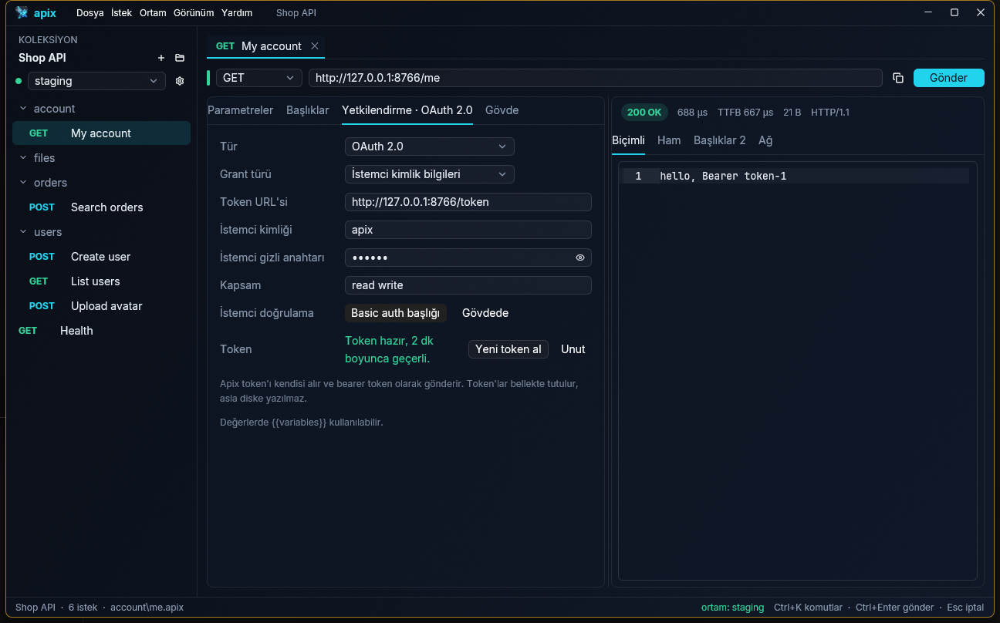

**OAuth 2.0 token'ları.** İlk gönderim bir token alır; sonraki gönderimler onu
yeniden kullanır ve süresi dolduğunda refresh token ile yeniler. **Yeni token al**
hemen bir token alır, **Unut** onu atar. Token'lar yalnızca bellekte tutulur ve
asla diske yazılmaz. Yetkilendirme kodu akışında Apix oturum açma sayfasını
tarayıcınızda açar ve yanıtı `http://127.0.0.1` üzerinde alır (boş bir port ya
da istemci için kaydettiğiniz **Yönlendirme URL'si**).

**Paylaşılan yetkilendirme.** Yetkilendirmeyi içindeki her şey için bir kez
ayarlamak üzere bir klasöre veya koleksiyona sağ tıklayıp **Yetkilendirme…**
seçin; **Ortam › Proje yetkilendirmesi…** aynısını tüm bir proje için yapar.
Yetkilendirmesi *Üst öğeden devral* olan istekler bunu kullanır.

## İstek ayarları

Ayarlar sekmesi isteğin nasıl yol alacağını belirler:

| Ayar | Varsayılan |
|---|---|
| Zaman aşımı (saniye) | yok — istek bitene ya da siz iptal edene kadar sürer; `0` da zaman aşımı yok demektir |
| Yönlendirmeleri izle | açık |
| En çok yönlendirme | 10 |
| TLS sertifikasını doğrula | açık — yalnızca güvendiğiniz test sunucuları için kapatın |
| Proxy | ortamdan (`HTTP_PROXY`, `HTTPS_PROXY`, `ALL_PROXY`); *Kapalı* bunları da yok sayar; bir URL proxy'yi açıkça belirtir |
| İstemci sertifikası | yok — PEM dosyası; anahtar aynı dosyada ya da ayrı bir dosyada |
| Çerez gönder | açık |

Boş bırakılan (ya da *Miras*ta kalan) her alan, onu ayarlayan en yakın
klasörden, koleksiyondan veya projeden, en sonunda da yukarıdaki
varsayılanlardan değer alır — yetkilendirmeyle aynı zincir. Bir klasöre veya
koleksiyona sağ tıklayıp **İstek ayarları…** seçerek içindeki her şey için bir
kez ayarlayın; **Ortam › Proje istek ayarları…** aynısını tüm bir proje için
yapar. Formun altındaki satır isteğin sonunda neyi kullanacağını gösterir.
Proxy ve sertifika alanlarında `{{değişkenler}}` çalışır; göreli sertifika
yolları, onları ayarlayan dosyaya göre çözülür.

İstek dosyasında (ve `folder.toml`, `apix.toml`, `apix-project.toml`
dosyalarında) ayarlar bir `[settings]` tablosudur:

```toml
[settings]
timeout_ms = 5000
tls_verify = false
proxy = ""          # "" = proxy yok, ortam ayarlasa bile
client_cert = "certs/client.pem"
```

**Komut olarak kopyala** karşılık gelen curl bayraklarını yazar (`-m`,
`-L --max-redirs`, `-k`, `-x`, `--cert`, `--key`); bu bayrakları taşıyan bir
curl komutu yapıştırıldığında sekme dolar. `apix send` komutunda dosyayı ezen
`--timeout`, `--insecure` ve `--proxy` bayrakları vardır. Postman'ın istek
başına seçenekleri (`protocolProfileBehavior`) içe aktarılır.

## Çerezler

Apix tek bir çerez kavanozu tutar: `Set-Cookie` yanıtları kendiliğinden
saklanır ve aynı siteye sonraki isteklerle gönderilir; yeniden başlatmalarda da
korunur (uygulama ayarlarının yanındaki `cookies.json`; oturum çerezleri
uygulamayla birlikte silinir). **İstek › Çerezler…** hepsini listeler, tek tek
siler ya da kavanozu boşaltır. Ayarlar sekmesindeki **Çerez gönder**, kavanozu
bir istek, klasör, koleksiyon veya proje için kapatır. CLI her çalıştırmada boş
bir kavanozla başlar.

## Değişkenler ve ortamlar

Bir URL'ye, başlığa, gövdeye veya yetkilendirme alanına `{{name}}` yazın; Apix
gönderirken değeri yerine koyar. URL çubuğunda her değişken renkli bir etikettir:
değerini ve nereden geldiğini görmek için üzerine gelin; kırmızı bir etiket hiçbir
yerde tanımlı değildir.

Değerler katmanlar hâlinde gelir, sonraki öncekini geçersiz kılar:

1. **Proje** değişkenleri (bir projenin tüm koleksiyonlarınca paylaşılır)
2. **Koleksiyon** değişkenleri (`apix.toml`)
3. Etkin **ortam** (`environments/<name>.toml`)

Bunları düzenlemek için **Ortam › Değişkenler ve ortamlar…** (Ctrl+E) menüsünü
açın. Token ve parolalar için **Gizli** kutusunu işaretleyin: gizli değerler
`environments/<name>.local.toml` dosyasında saklanır; Apix bu dosyayı
`.gitignore`'a ekler, böylece asla commit'lenmezler.

Diskte de durmasınlar isterseniz **Ayarlar › Ortam gizli değerleri › Sistem
anahtarlığı** seçeneğini seçin. Değerler sistemin kimlik bilgisi deposuna gider
(Windows'ta Credential Manager, macOS'te Anahtar Zinciri, Linux'ta Secret
Service); `<name>.local.toml` yalnızca o kaydın kimliğini tutar, böylece ortamı
yeniden adlandırmak ya da klasörü taşımak sorun çıkarmaz. `apix` komut satırı da
onları aynı yoldan okur. Ayar değişince açık koleksiyon veya projenin gizli
değerleri hemen taşınır; diğerleri bir sonraki kaydedişte taşınır. Şifreli bir
koleksiyonun gizli değerleri her zaman kendi içinde kalır.

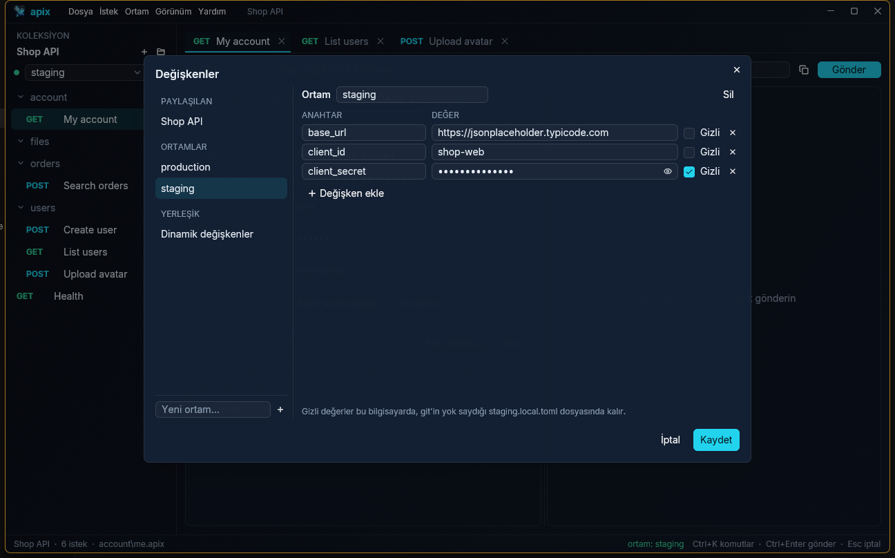

**Dinamik değişkenler** her kullanımda yeni bir değer alır: `{{$guid}}`,
`{{$timestamp}}`, `{{$isoTimestamp}}`, `{{$randomInt}}`, `{{$randomEmail}}` ve
daha fazlası; Değişkenler iletişim kutusunun **Dinamik değişkenler** sayfası
hepsini örnek bir değerle listeler.

## Yanıt

Yanıt bölmesi durumu, ilk bayta kadar geçen süreyi ve toplam süreyi, ayrıca
boyutu gösterir. **Biçimli** JSON'u biçimlendirir (blokları oklarla katlayın),
XML ve HTML'i girintiler ve renklendirir; **Ham** gövdeyi alındığı gibi
gösterir, **Başlıklar** yanıt başlıklarını listeler, **Hex** baytları gösterir.
Çok büyük gövdeler (onlarca megabayt) yalnızca görünen satırları çizen hızlı
bir görüntüleyicide açılır.

Apix gövdenin türünü `Content-Type`'tan, tür bir şey söylemiyorsa baytların
kendisinden anlar. Resimler (PNG, JPEG, GIF, WebP, BMP, SVG) **Biçimli**
sekmesinde gösterilir; diğer ikili içerik (PDF, zip…) okunamaz metin yerine
kısa bir özetle görünür. İsteğe bağlı kapanış etiketlerini atlayan HTML
yeniden biçimlendirilmez, geldiği gibi gösterilir.

Durum satırının sonundaki **↓** düğmesi gövdeyi bayt bayt bir dosyaya kaydeder.
Önerilen ad sunucunun `Content-Disposition` başlığından ya da URL'den gelir;
uzantı içeriğe göre seçilir.

## Ağ sekmesi

**Ağ** sekmesi, sürenin nereye gittiğini ve bağlantının nasıl olduğunu açıklar:

- DNS, bağlanma, bekleme ve indirme olarak bölünmüş bir zamanlama çubuğu
- DNS yanıtları, sunucu ve yerel adres, ağ arayüzü (VPN kullanılıyorsa bir
  ipucuyla), ağ geçidi, DNS sunucuları ve proxy
- her yönlendirme
- sunucu sertifikası: veren, geçerlilik ve kalan gün sayısı

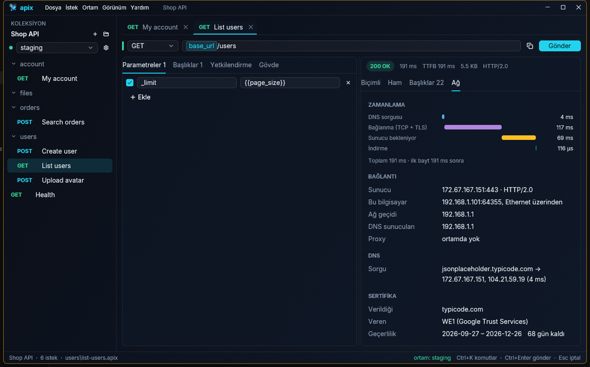

## WebSocket ve sunucu olayları (SSE)

**WebSocket.** Adresi `ws://` ya da `wss://` ile başlayan istek bir
WebSocket'tir: **Gönder** düğmesi **Bağlan** olur, Gövde sekmesi de
**Mesajlar** olur. El sıkışma, her istekte olduğu gibi isteğin
parametrelerini, başlıklarını ve yetkilendirmesini (Bearer, Basic, API
anahtarı, OAuth 2.0 …) kullanır.

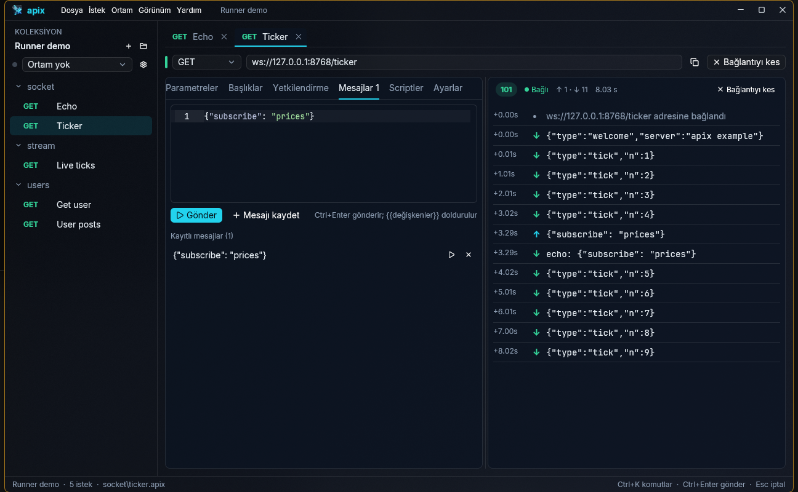

- Bir mesaj yazıp **Gönder**'e (ya da Ctrl+Enter'a) bas. `{{değişkenler}}`
  gönderilirken doldurulur. Bağlantı yoksa Apix önce bağlanır, açılınca
  mesajı gönderir.
- **Mesajı kaydet** mesajı istek dosyasında `[[message]]` olarak tutar;
  dosyayı Ctrl+S kaydeder. Düzenlemek için kayıtlı bir mesaja tıkla, olduğu
  gibi göndermek için ▷'ye bas.
- Yanıt alanı bir günlüktür: ↑ gönderilen, ↓ gelen, bağlantıdan bu yana
  geçen süreyle; ayrıca ne zaman bağlandığı ve nasıl kapandığı (kod ve
  neden). Yukarı kaydırmadıkça yeni mesajları izler.
- **Bağlantıyı kes** (ya da Esc) bağlantıyı kapatır; günlük yeniden
  bağlanana kadar kalır. Sekmesi arkadayken de bağlantı sürer.

**Sunucu olayları (server-sent events).** Bir yanıt `text/event-stream` ise
olayları geldikçe görünür: zamanı, olay türü ve kimliği, sonra verisi.
**Durdur** (ya da Esc) akışı bitirir ve gelenleri tutar; sunucunun bitirdiği
bir akış aynı listeyi Biçimli sekmesinde gösterir, Ham, Başlıklar, Ağ ve Hex
her yanıttaki gibidir. Sunucu istiyorsa `Accept: text/event-stream`
başlığını gönder. Ayarlar'daki istek zaman aşımı bir akışı da bitirir; açık
kalan akışlar için onu boş bırak.

Komut satırında `apix send` olayları geldikçe yazar; bir WebSocket'te
bağlanır, kayıtlı mesajları (ya da `--message` metinlerini) gönderir, iki
yöndekileri yazar ve `--listen` saniye sonra kapatır (varsayılan 3, `0`
sunucuyu bekler). `apix run` WebSocket isteklerini atlar.

## gRPC

Adresi `grpc://` (TLS için `grpcs://`) ile başlayan istek bir gRPC metodunu
çağırır: adres çubuğunda **gRPC** yazar, Gövde sekmesi de **Mesaj** olur.

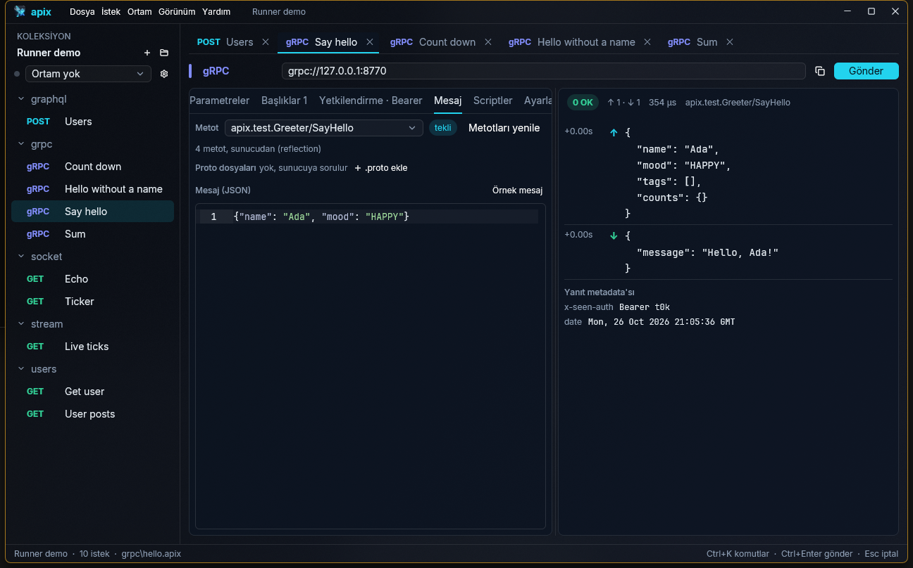

1. Adresi yaz, örneğin `grpc://localhost:50051`.
2. **Metotları yükle** sunucuya neler sunduğunu sorar (gRPC sunucu
   reflection'ı). Sunucuda reflection yoksa **.proto ekle** ile servisin
   `.proto` dosyalarını seç; import'lar onların yanında aranır, Google'ın
   bilinen türleri yerleşiktir. Hiçbir şey için `protoc` gerekmez.
3. Metodu seç. Türü yanında görünür: tekli, sunucu akışı, istemci akışı ya da
   çift yönlü.
4. Mesajı JSON olarak yaz ya da her alanı dolu bir örnek için **Örnek mesaj**'a
   bas. Akış alan bir metotta JSON listesi, her öğe için bir mesaj gönderir.
5. **Gönder** (Ctrl+Enter). Yanıt alanı gidenleri (↑) ve gelenleri (↓)
   zamanlarıyla listeler; sonra durumu (`0 OK` ya da mesajıyla birlikte
   `5 NOT_FOUND` gibi bir kod), yanıt metadata'sını ve trailer'ları gösterir.
   Bir akış mesajlarını geldikçe gösterir; Esc durdurur.

Başlıklar metadata olarak gider; yetkilendirme HTTP'deki gibi çalışır:
Bearer, Basic, başlıkta API anahtarı ve OAuth 2.0. İstek ayarlarındaki zaman
aşımı ve istemci sertifikası geçerlidir. `-bin` ile biten bir başlık base64
olarak okunur.

Komut satırında `apix send` metodu çağırır (akışlar geldikçe her mesaj bir
satıra yazılır; durum OK değilse çıkış kodu sıfırdan farklıdır), `apix schema`
servisi ve mesajlarını yazar. `apix run` gRPC isteklerini şimdilik atlar.

## Scriptler ve testler

**Scriptler** sekmesi istek için iki JavaScript scripti tutar:

- **İstek öncesi**, istek gönderilmeden önce çalışır. İsteği değiştirebilir
  (`pm.request.headers.upsert(…)`, `pm.request.url.query.add(…)`,
  `pm.request.body.raw = …`) ve değişken atayabilir
  (`pm.environment.set("token", …)`).
- **Testler**, yanıt geldikten sonra çalışır ve onu denetler:

```js
pm.test("durum 200", () => pm.response.to.have.status(200));
pm.test("kullanıcılar var", () => {
  const body = pm.response.json();
  pm.expect(body.users).to.be.an("array").that.is.not.empty;
});
```

API, Postman'ın `pm.*` API'sidir (`apix.*` olarak da kullanılabilir), bu
yüzden Postman'dan gelen scriptler olduğu gibi çalışır: `pm.environment`,
`pm.collectionVariables`, `pm.globals` (projenin değişkenleri),
`pm.variables`, `pm.request`, `pm.response`, `pm.test`, Chai tarzı
denetimlerle `pm.expect`, `pm.info`, `console.log` ve eski
`tests["…"] = …` ile `postman.setEnvironmentVariable(…)`.

`pm.sendRequest` bir scriptten başka bir istek gönderir, örneğin önce token
almak için; hem `pm.sendRequest(req, (err, res) => …)` hem
`const res = await pm.sendRequest(req)` çalışır. `require(…)`, API
scriptlerinin kullandığı kısımlarıyla `crypto-js` (MD5, SHA-1, SHA-2 ve
bunların HMAC'leri, Base64/Hex/UTF-8 kodlayıcıları), `uuid`, `lodash` (`_`
olarak da), `moment`, `ajv`, `tv4` ve `chai` sunar; bunlar yerleşiktir, hiçbir
şey indirilmez. Bir kütüphanede olmayan bir fonksiyon açık bir mesajla hata
verir.

Scriptler sekmesinin üçüncü bölümü **Doğrulamalar**, yanıtı kod yazmadan
denetler: her satır bir hedefi bir değerle karşılaştırır. Hedefler `status`,
`time` (ms), `size` (bayt), `body`, `body.users[0].id` gibi bir JSON yolu ya da
`header.Content-Type`; karşılaştırmalar `==`, `!=`, `>`, `>=`, `<`, `<=`,
`contains`, `not contains`, `exists`, `not exists`, `matches` (`/^ok/i` gibi
bir düzenli ifade) ve `is` (bir JSON türü). Değerlerde `{{değişkenler}}`
kullanılabilir. Doğrulamalar istek dosyasına `[[assert]]` olarak kaydedilir
ve uygulamada da `apix run`'da da test olarak görünür.

Bir yanıttan değer saklamak için durum satırının yanındaki **{x}** düğmesini
kullanın: değeri (Doğrulamalar'daki hedeflerle aynı) ve bir değişken adını
verin; değer seçili ortama (ortam yoksa koleksiyon değişkenlerine) kaydedilir.
**Her gönderimde güncelle** işaretlenirse uygun `pm.environment.set(…)`
satırı da Testler scriptine eklenir.

Scriptler ait oldukları şeyin yanında dosya olarak durur: istek için yanında
`<istek>.prerequest.js` ve `<istek>.test.js`, klasör için içinde
`_folder.prerequest.js` / `_folder.test.js`, koleksiyon için kökte
`_collection.prerequest.js` / `_collection.test.js`. Dıştan içe çalışırlar:
önce koleksiyon, sonra klasörler, en son istek. Ctrl+S isteğin scriptlerini de
kaydeder; gönderirken kaydetmeden önce bile editördeki metin kullanılır.

Gönderdikten sonra yanıt panelinde bir **Testler** sekmesi (✓ geçti, ✗ kaldı
ve nedeni) ve `console.*` çıktılarını gösteren bir **Konsol** sekmesi çıkar.
İstek öncesi script hata verirse istek gönderilmez ve hata hangi dosyanın
patladığını söyler. Scriptler 10 saniye sonra durdurulur.

Bir scriptin atadığı değerler hiçbir dosyaya yazılmaz. Apix açık kaldıkça
geçerlidir (ortam değişince `pm.environment.set` ile atananlar düşer) ve
değişken kartlarında “Bir script atadı” olarak görünür. `pm.variables.set`
yalnızca bir gönderim boyunca geçerlidir.

## Runner

**Runner** birçok isteği tek seferde gönderir ve hepsini denetler. İçinde
bulunduğun koleksiyon için **Görünüm › Runner…** ya da Ctrl+Shift+R ile,
yalnızca bir bölümü için kenar çubuğunda bir koleksiyona ya da klasöre sağ
tıklayıp **Çalıştır…** ile açılır.

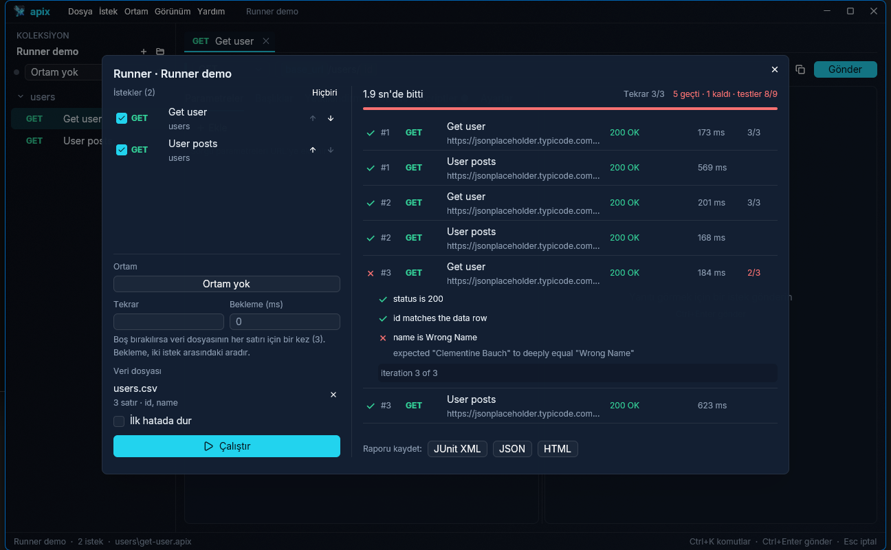

- **İstekler**: kenar çubuğu sırasıyla tüm istekler, işaretli olarak.
  Dışarıda kalacakların işaretini kaldır; bu koşunun sırasını değiştirmek
  için bir isteği ↑ ↓ ile taşı.
- **Ortam**: hangi ortamın değişkenlerinin kullanılacağı.
- **Tekrar**: isteklerin kaç kez dolaşılacağı. Boş bırakılırsa bir kez; veri
  dosyası varsa her satır için bir kez.
- **Bekleme (ms)**: iki istek arasındaki ara; istek sınırı olan API'ler için.
- **Veri dosyası**: veri odaklı koşu için bir CSV ya da JSON dosyası. Her satır
  bir tekrardır ve sütunları değişken olur: istekte `{{email}}`, scriptlerde
  `pm.iterationData.get("email")`. CSV'nin ilk satırı başlık olmalı; tırnaklı
  değerler ve noktalı virgülle ayrılmış dosyalar (Türkçe Excel'in yazdığı
  gibi) okunur. JSON bir nesne dizisidir: `[{"id": 1, "email": "a@x.test"}, …]`.
- **İlk hatada dur**: başarısız olan ilk istekte koşuyu bitirir.

Bir istek testleri (scriptler ve Doğrulamalar) geçerse geçer; testi olmayan
bir istek 2xx ya da 3xx durum koduyla geçer. Koşu sürerken **Duraklat**,
**Devam et** ve **Durdur** (gönderilmekte olan istekten sonra) kullanılabilir.
Pencereyi kapatmak koşuyu durdurmaz: Runner'ı yeniden açınca kaldığı yerden
görünür. Bir sonuca tıklayınca testleri, neden gönderilmediği ve konsol
satırları açılır. `pm.execution.setNextRequest("ad")` koşudaki başka bir
isteğe atlar, `setNextRequest(null)` o tekrarı bitirir; Postman'daki gibi.

Runner isteklerin kayıtlı halini gönderir. Koşudan önce scriptlerin atadığı
değerler kullanılır; koşunun scriptlerinin atadıkları koşunun içinde kalır.

Koşu bitince **Raporu kaydet** onu **JUnit XML** (CI test görünümleri için),
**JSON** (olan her şey) ya da **HTML** (her tarayıcıda açılan, açık ve koyu
temalı bir sayfa) olarak yazar. `apix run` aynısını terminalden yapar; bkz.
[Koleksiyonu CI'da çalıştırma](workflows.md#koleksiyonu-cida-çalıştırma).

## Sekmeler

Her sekme kaydedilmemiş düzenlemelerini, son yanıtını ve hatta hâlâ çalışan bir
isteği korur. Ctrl+Tab ve Ctrl+Shift+Tab sekmeler arasında geçiş yapar, Ctrl+W
veya orta tıklama bir sekmeyi kapatır; Apix kaydedilmemiş değişiklikleri
kapatmadan önce sorar. Açık olan sekmeler aynı koleksiyon ya da proje bir
sonraki açılışta yeniden gelir (şifreli koleksiyonların sekmeleri hatırlanmaz,
çünkü dosya adları da gizlidir).

## Kenar çubuğunda istekleri düzenleme

İstek ve klasör oluşturmak, yeniden adlandırmak, çoğaltmak veya silmek için
kenar çubuğuna sağ tıklayın; silinen dosyalar sistemin çöp kutusuna gider. Bir
isteği veya klasörü başka bir klasörün ortasına sürükleyince oraya taşınır.
Bir satırın üst ya da alt kenarına bırakırsanız o satırın önüne ya da arkasına
yerleşir; nereye gideceğini bir çizgi gösterir. Sıra `apix.toml` (koleksiyonun
üst düzeyi için) ve `folder.toml` (bir klasör için) içinde `order` listesi
olarak saklanır, böylece git ile paylaşılır; listede olmayanlar ada göre
arkadan gelir. Postman içe aktarma Postman'daki sırayı korur, Postman'a dışa
aktarma da sizin sıranızı izler.

## Projeler

**Proje**, birbirine ait birkaç koleksiyonu bir araya getirir ve ortamları ve
yetkilendirmeyi aralarında paylaştırır. **Dosya › Yeni proje…** ile bir tane
oluşturun. Bir projede **Ortam › Kenar çubuğunu grupla** kenar çubuğunu
Proje › Ortam › Koleksiyonlar düzeninde gösterebilir.

- Sıralarını değiştirmek için bir koleksiyon başlığını başka birinin üstüne ya
  da altına sürükleyin.
- Bir koleksiyona sağ tıklayıp › **Renk** ile ona renk verin; renk kenar
  çubuğunda ve isteklerinin sekmelerinde nokta olarak görünür. Renkler
  `apix-project.toml` içinde saklanır.
- **Dosya › Bir projeye taşı…** (tek koleksiyon açıkken) o koleksiyonun
  klasörünü seçtiğiniz projeye taşır. Bir proje açıkken dosya yöneticisinden bir
  koleksiyon klasörünü pencereye bırakmak da aynısını önerir.

## Şifreli koleksiyonlar

Şifreli bir koleksiyon her isteği, ortamı ve hatta dosya adlarını diskte mühürlü
tutar (Argon2id ile paroladan türetilen anahtarla XChaCha20-Poly1305). Git
yalnızca hangi şifreli blob'un değiştiğini görür.

- **Dosya › Bu koleksiyonu şifrele…** ya da bir koleksiyona sağ tıklayıp ›
  **Şifrele…** mevcut bir koleksiyonu yerinde şifreler.
- **Dosya › Yeni şifreli koleksiyon…** bir proje içinde yeni bir tane oluşturur.
- Bir **kurtarma anahtarı** yalnızca bir kez gösterilir. Güvenli bir yerde
  saklayın: parola kaybolursa koleksiyonu bu anahtar açar.
- Koleksiyonu açarken parola sorulur. **Dosya › Şifreli koleksiyonları kilitle**
  seçtiğinizde, Apix'ten çıktığınızda veya Ayarlar'da belirlenen süre (varsayılan
  15 dakika) boyunca boşta bıraktığınızda yeniden kilitlenir.
- Kilit açma penceresinde **Bu bilgisayarda hatırla** işaretlenirse parola
  sistemin kimlik bilgisi deposunda saklanır (Windows'ta Credential Manager,
  macOS'te Anahtar Zinciri, Linux'ta Secret Service). Bundan sonra oturumunuz
  açıkken koleksiyon parola sormadan açılır; `apix` komut satırı da kayıtlı
  parolayı kullanır. **Dosya › Kayıtlı parolayı unut** (ya da koleksiyona sağ
  tık) parolayı siler. Parola başka bir yerde değiştirildiyse kayıtlı olan
  silinir ve Apix yeniden sorar.

## Komut olarak kopyala ve curl yapıştırma

**Gönder** düğmesinin yanındaki kopyala düğmesi (veya **İstek › Komut veya kod
olarak kopyala**) isteği bash ya da fish için `curl`, Windows komut istemi için
`curl.exe`, bir PowerShell `Invoke-RestMethod` çağrısı, bir HTTPie `http` komutu
(HTTPie 3.0 ve sonrası) ya da bir GNU `wget` komutu olarak, değişkenler
doldurulmuş şekilde kopyalar. wget multipart form gönderemez; kopyalanan komut
bunu not olarak yazar. Her gönderimde imzalanan istekler (OAuth 1.0,
PowerShell ve kod için AWS) kopyaladığınız anda imzalanır.

Aynı menü isteği bir program olarak da kopyalar: JavaScript `fetch`, Node.js
axios, Python requests, Go `net/http`, Rust reqwest, C# `HttpClient`, Java
`HttpClient`, PHP cURL, Swift `URLSession` veya Kotlin OkHttp. Her biri Apix'in
göndereceğini gönderir — URL, başlıklar, yetkilendirme ve her gövde tipi — ve
dilin ifade edebildiği istek ayarlarını da yazar (zaman aşımı, yönlendirmeler,
TLS denetimi, proxy, istemci sertifikası). Bir dilde basit bir karşılığı olmayan
ayar sessizce atlanmaz; kodun başında `Not in this snippet` yorumuyla
listelenir. Kenar çubuğunda bir isteğe sağ tıklayıp **Kod olarak kopyala**
menüsünü kullanın.

CLI de aynısını yazar: `apix code istek.apix --as python` (`apix shell` aynı
komuttur; `--as` şunları alır: `bash`, `cmd`, `powershell`, `fetch`, `axios`,
`python`, `go`, `rust`, `csharp`, `java`, `php`, `swift`, `kotlin`).

URL alanına bir `curl` komutu yapıştırın (örneğin tarayıcınızın "Copy as cURL"
seçeneğinden); Apix isteğin tamamını doldurur: metot, URL, sorgu, başlıklar,
yetkilendirme ve gövde.

## Postman'dan içe aktarma

**Dosya › İçe aktar…** menüsünü kullanın ya da bir Postman dışa
aktarımını pencereye bırakın. Koleksiyonlar (v2.0 ve v2.1) ve ortamlar
desteklenir. Klasörler, istekler, gövdeler, yetkilendirme ve değişkenler
aktarılır; Apix'in henüz devralamadığı her şey bir raporda listelenir.
Pre-request ve test betikleri isteklerinin yanında `.js` dosyaları olarak
saklanır, ortamlardaki gizli değerler ise git'in yok saydığı `.local.toml`
dosyasına gider.

**Birçok dosya birden.** Postman dışa aktarımları içeren bir klasörü — ya da
Postman'ın *Export data* ile verdiği zip'i — açın veya bırakın; Apix dosyaları
adlarına değil içeriklerine bakarak tanır ve hepsini tek bir proje olarak içe
aktarmayı önerir: her Postman koleksiyonu için bir koleksiyon, hepsinin
paylaştığı ortamlar ve proje değişkeni olarak globals (proje değişkenleri
commit'lendiği için gizli globals alınmaz). Aynı adlı iki ortam `ad` ve `ad-2`
olarak saklanır.

**Postman'a dışa aktarma.** Bir koleksiyona sağ tıklayıp **Postman'a dışa
aktar…** (veya **Dosya › Postman'a dışa aktar…**) seçin; bir Postman v2.1
koleksiyon dosyası ve her ortam için bir ortam dosyası yazılır, böylece
Postman kullanan ekip arkadaşları onunla çalışmaya devam edebilir. Klasörler,
yetkilendirme, gövdeler, betikler, değişkenler ve yönlendirme, TLS ve çerez
ayarları aktarılır. Postman'da istek başına zaman aşımı, proxy ve istemci
sertifikası yoktur; gizli ortam değerleri de yalnızca adlarıyla dışa
aktarılır. Bildirim, nelerin aktarılmadığını listeler.

Komut satırında: `apix import <dosya, klasör veya zip>` ve
`apix export <koleksiyon> --out <klasör>`.

## Insomnia, OpenAPI ve HAR'dan içe aktarma

**Dosya › İçe aktar…** (veya dosyayı pencereye bırakmak) bunları da okur; biçim
içerikten tanınır, bir klasör ya da zip bunları karışık içerebilir:

| Biçim | Ne elde edersiniz |
|---|---|
| Insomnia v4 (JSON dışa aktarım) | Her çalışma alanı için bir koleksiyon, auth'larıyla klasörler, koleksiyon değişkeni olarak temel ortam ve ortam olarak her alt ortam. `{{ _.ad }}`, `{{ad}}` olur. |
| OpenAPI 3 / Swagger 2 (JSON veya YAML) | Her işlem için bir istek, her etiket için bir klasör. Sunucu `baseUrl` değişkeni olur (birden fazla sunucu varsa her biri bir ortam), yol parametreleri örnek değerleriyle değişken olur, zorunlu sorgu ve başlık parametreleri açık gelir, gövdeler örneklerden alınır ya da şemadan üretilir, güvenlik tanımları da bir ortamda doldurulacak boş kimlik değişkenleriyle (`bearerToken`, `apiKey`, …) auth'a dönüşür. |
| HAR (tarayıcı geliştirici araçlarında "Save all as HAR") | Yalnızca API çağrıları, ana makine başına bir klasör. Betikler, stiller, resimler ve fontlar, `data:` adresleri ve tekrarlar alınmaz; tarayıcının oturumunu taşıdığı için `Cookie` başlıkları da alınmaz. |

Tek dosyadan tek koleksiyon çıkarsa koleksiyon olarak, birden fazlası proje
olarak içe aktarılır. Rapor, aktarılamayan her şeyi listeler.

## Geçmiş

Gönderdiğiniz her istek yanıtıyla birlikte saklanır. **Görünüm › Geçmiş…**
(Ctrl+H) onları en yeniden eskiye metot, ad, URL, durum ve gönderilme
zamanıyla listeler; bunlardan herhangi birine göre aramak için yazın. Bir kayıt
seçtiğinizde istek, gönderildiği sekmeye kaydedilmemiş değişiklik olarak, o an
aldığı yanıtla birlikte geri gelir. Yeniden göndermek için Ctrl+Enter, o hâlini
saklamak için Ctrl+S'ye basın. İstek dosyası artık yoksa kayıt düzenleyicide
sekmesiz açılır.

Geçmiş yalnızca bu bilgisayarda kalır (ayarların yanındaki `history`
klasörü), hiçbir zaman bir koleksiyonun içine yazılmaz. İstekler yazıldığı
gibi, `{{değişkenler}}` çözülmeden saklanır; böylece ortamlardaki gizli
değerler geçmişe kopyalanmaz. Son 300 istek, her birinin yanıt gövdesi en çok
256 KB olarak tutulur. Şifreli koleksiyonlardaki istekler geçmişe hiç
yazılmaz. Penceredeki **Geçmişi temizle** onu boşaltır; **Dosya › Ayarlar… ›
Geçmiş** kapatır.

## Komut paleti

Ctrl+K (veya Ctrl+P) komut paletini açar: bir istek adının veya komutun birkaç
harfini yazıp Enter'a basın. Komutlar her dilde İngilizce adlarıyla da
bulunabilir.

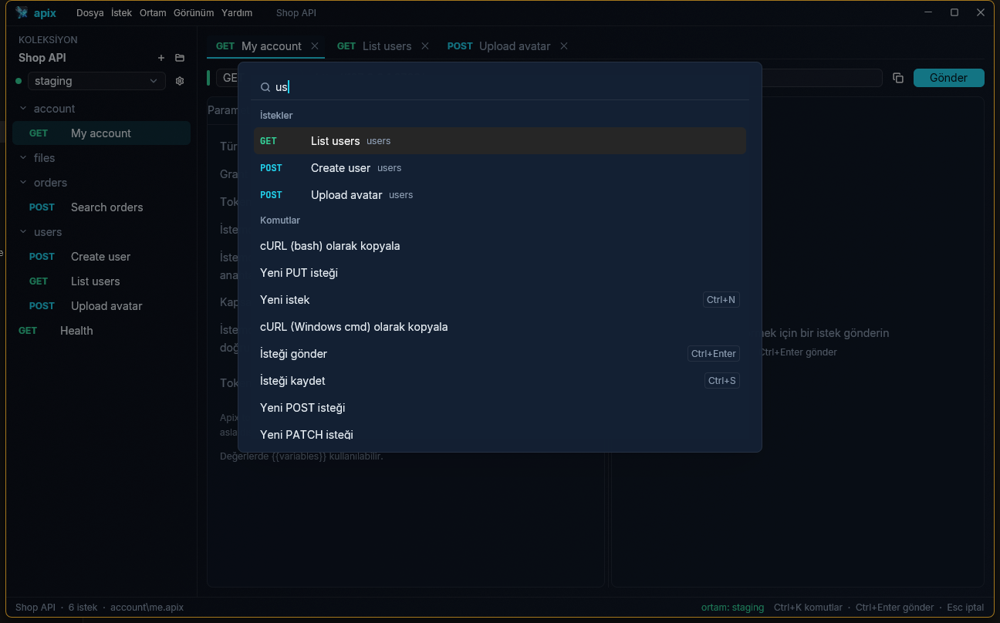

## Ayarlar ve dil

**Dosya › Ayarlar…** (Ctrl+,):

- **Dil:** English, Türkçe, العربية, Deutsch, Français, Русский, 日本語,
  简体中文 veya Español. Değişiklik hemen uygulanır. İlk açılışta Apix sistem
  dilini izler. Arapçada pencere aynalanır: kenar çubuğu sağdadır, menüler,
  sekmeler ve formlar sağdan başlar; URL'ler, kod ve anahtar–değer tabloları
  soldan sağa kalır.
- **Şifreli koleksiyonları kilitle:** 5, 15 veya 30 dakika sonra, 1 saat sonra
  ya da hiçbir zaman.
- **Ortam gizli değerleri:** `.local.toml` dosyasında ya da sistem
  anahtarlığında (bkz. [Değişkenler ve ortamlar](#değişkenler-ve-ortamlar)).
- **Üretimde onay iste:** “prod” ortamı seçiliyken DELETE, PUT veya PATCH
  öncesi sor (varsayılan olarak açık).
- **Geçmiş:** açık veya kapalı (bkz. [Geçmiş](#geçmiş)).

Ayarların **Tema** bölümü Apix'in görünüşünü yeniden başlatmadan, hemen
değiştirir:

- **Görünüm:** koyu, açık ya da **Sistemi izle**; sonuncusu Windows veya macOS
  açık ve koyu mod arasında geçtiğinde değişir.
- **Koyu tema:** Obsidyen (varsayılan), Siber cam, Dracula, Nord veya
  Solarized Dark. **Açık tema:** Gün ışığı veya Solarized Light. Diğer türden
  bir tema seçmek görünümü de ona geçirir.
- **Vurgu rengi:** temanın kendi rengi ya da camgöbeği, mavi, mor, pembe,
  kırmızı, turuncu, sarı veya yeşil; düğmeler, seçimler, odak çerçeveleri ve
  değişken çipleri için. Açık temalarda daha koyu tonu kullanılır; vurgu
  üzerindeki yazı, hangisi daha iyi okunuyorsa koyu ya da beyazdır.
- **Saydamlık:** 0'dan (düz renk pencere) %90'a bir kaydırıcı: masaüstünün
  pencereden ne kadar, buzlu cam gibi bulanık (Windows'ta akrilik, macOS'ta
  vibrancy) görüneceği. Pencere arka planı onunla açılır, paneller yazının
  arkası boş kalmasın diye daha yavaş açılır, kenarlar camın kenarı gibi
  parlaklaşır; menüler ve pencereler düz kalır. Koyu yazı açık bir zemine
  ihtiyaç duyduğundan açık temalar daha az açılır. Varsayılan %20'dir.
- **Kendi temaların:** **Klasörü aç** `<config>/Apix/themes` klasörünü açar ve
  ilk seferde oraya başlangıç için `my-theme.toml` yazar. O klasördeki her
  `.toml` dosyası listelerde bir temadır; yerleşik bir temayla aynı adı taşıyan
  dosya (`nord.toml`) onun yerine geçer. Okunamayan dosya nedeniyle birlikte
  kırmızı yazılır.

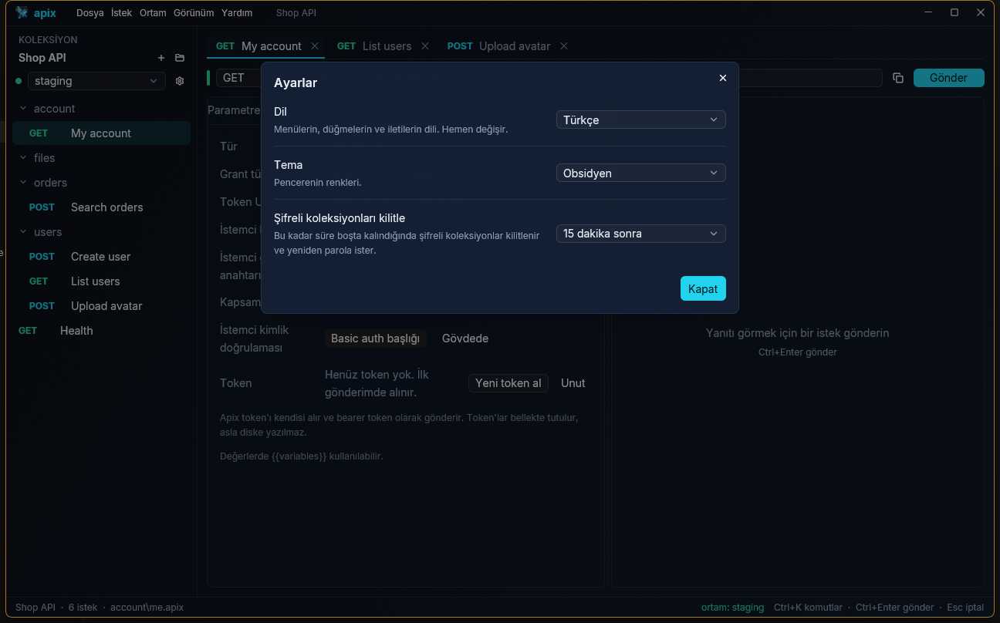

Bir tema dosyası bir ad, açık olup olmadığı ve şu renklerden istediklerini
verir (`#RRGGBB` ya da saydamlıkla `#RRGGBBAA`); vermedikleri Obsidyen'den, açık
temada Gün ışığı'ndan gelir:

```toml
name = "Deep sea"
light = false

[colors]
background = "#03141FEE"      # pencere, background_end'e doğru bir geçiş
background_end = "#062A3AEE"
surface = "#05202DB3"         # paneller
raised = "#0A2B3BF7"          # menüler ve pencereler
border = "#FFFFFF14"
accent = "#FF9F43"
text = "#E8F6FF"
muted = "#7FA3B8"
ok = "#34D399"                # 2xx, geçen testler
warning = "#FBBF24"
error = "#F87171"
string = "#86EFAC"            # büyük gövde görüntüleyicisinde JSON
number = "#FDBA74"
keyword = "#C4B5FD"
```

Tema dosyaları düz metindir, ekipçe paylaşılabilir; Apix onları açılışta ve
Ayarlar açıldığında okur.

Ayarlar, sisteminizin yapılandırma dizinindeki Apix klasöründe `settings.toml`
dosyasına kaydedilir (Windows'ta `%APPDATA%\Apix`, macOS'ta
`~/Library/Application Support/Apix`, Linux'ta `~/.config/Apix`).

## Klavye kısayolları

| Tuşlar | İşlem |
|---|---|
| Ctrl+Enter | Gönder |
| Esc | İsteği iptal et |
| Ctrl+S | Kaydet |
| Ctrl+N | Yeni GET isteği |
| Ctrl+O | Klasör, proje veya koleksiyon aç |
| Ctrl+K veya Ctrl+P | Komut paleti |
| Ctrl+E | Değişkenler ve ortamlar |
| Ctrl+, | Ayarlar |
| Ctrl+H | Geçmiş |
| Ctrl+Shift+R | Runner |
| Alt+1…7 | Metodu değiştir |
| Ctrl+W | Sekmeyi kapat |
| Ctrl+Tab / Ctrl+Shift+Tab | Sonraki / önceki sekme |
| Ctrl+Space | GraphQL sorgusunda öneriler (şema getirildikten sonra) |

macOS'ta Ctrl yerine ⌘ kullanın (Ctrl+Tab ve Ctrl+Space, Ctrl olarak kalır).
