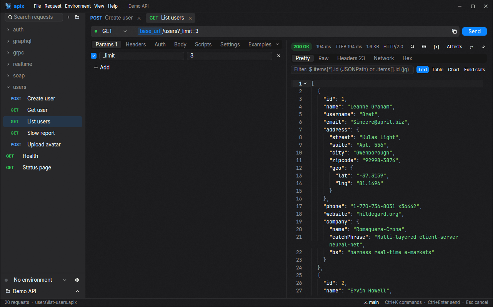
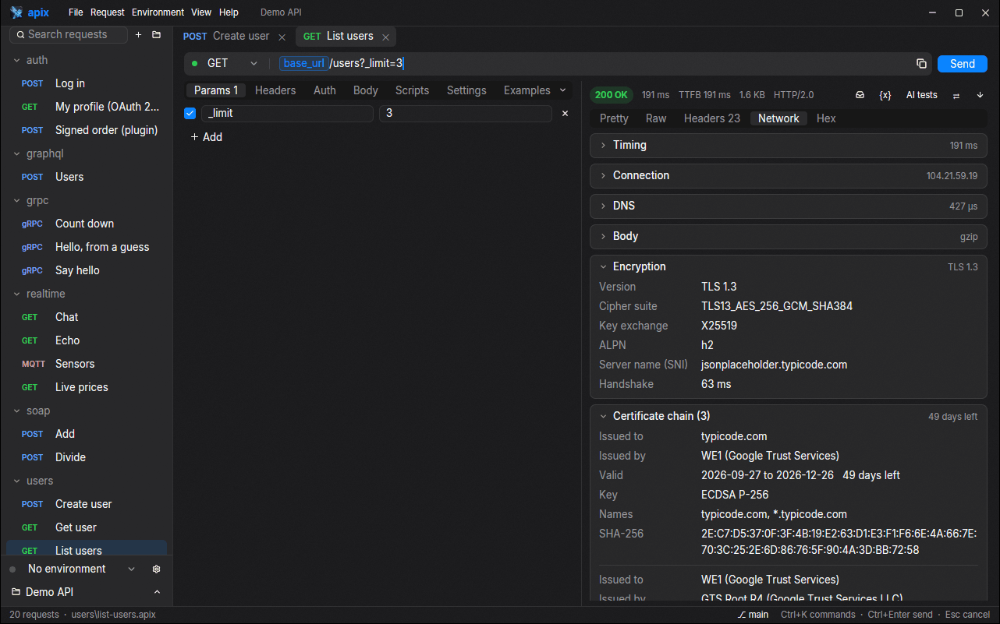
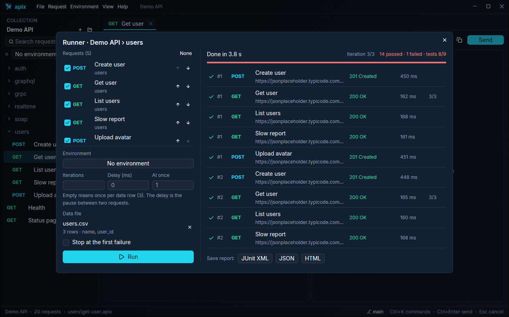
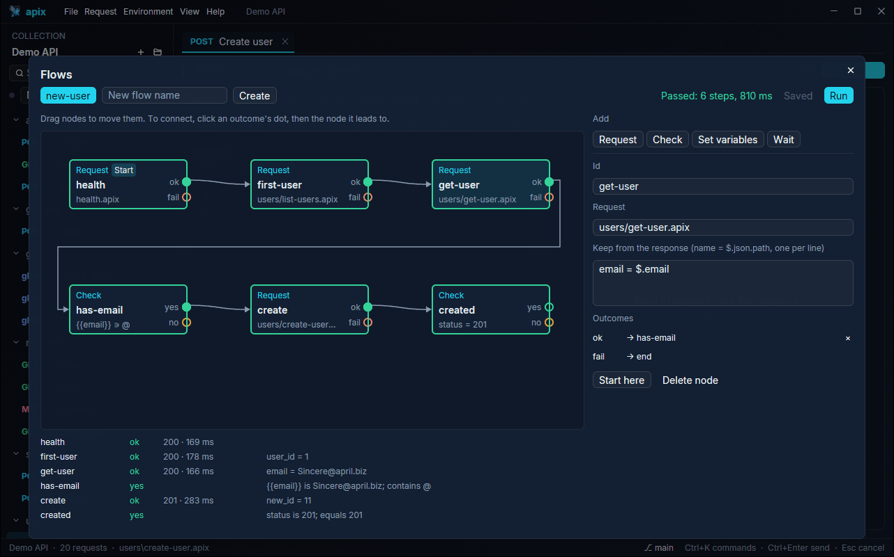
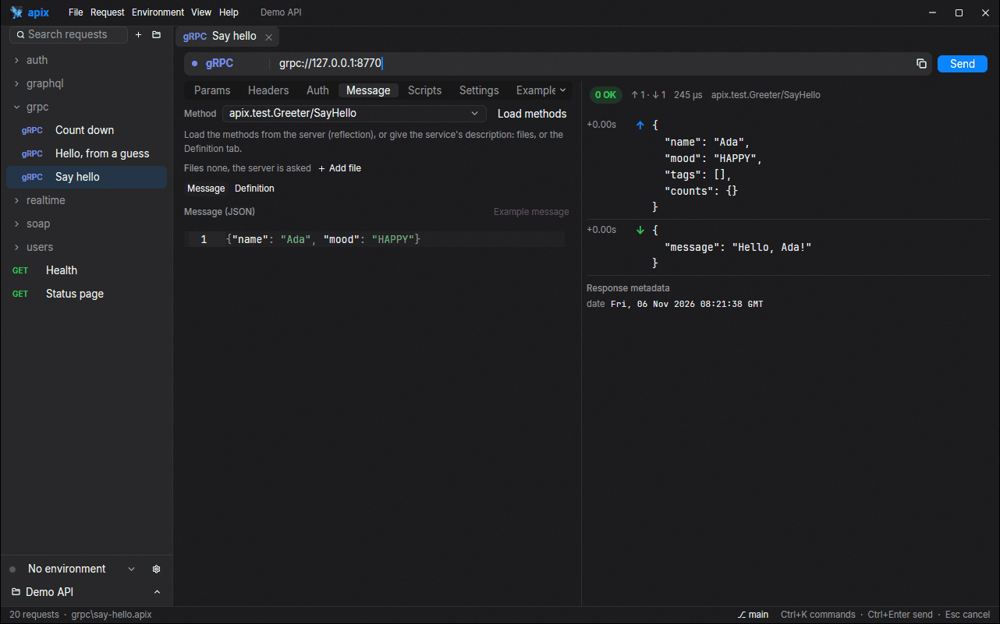
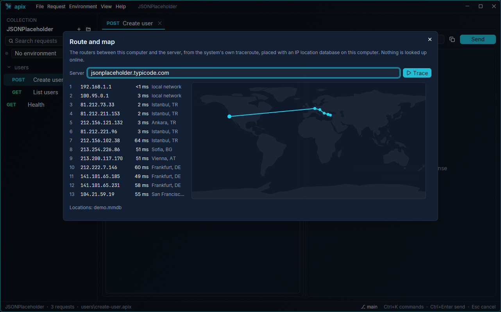
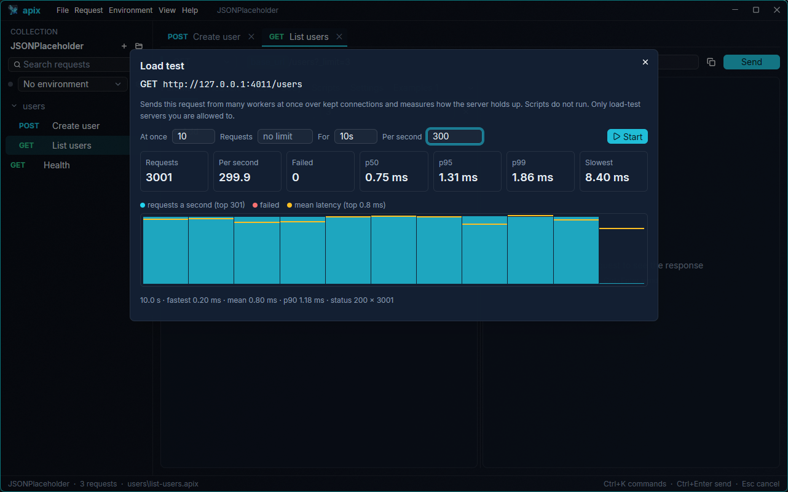

<p align="center"></p>

<h1 align="center">Apix</h1>

<p align="center"><b>A fast, native API client and command line, built with Rust and GPUI.</b><br>
Your requests are plain files in your repository. No Electron, no account, no cloud.</p>

<p align="center">
<a href="https://11r5.github.io/Apix/"></a>
<a href="https://github.com/11R5/Apix/actions/workflows/ci.yml"></a>
<a href="LICENSE"></a>
<a href="https://11r5.github.io/Apix/docs/"></a>
<a href="Docs/en/workflows.md#github-actions"></a>
</p>

<p align="center">
<a href="https://11r5.github.io/Apix/"><b>Download</b></a> ·
<a href="https://11r5.github.io/Apix/docs/"><b>Documentation</b></a> ·
<a href="#every-feature">Features</a> ·
<a href="#compared-with-similar-tools">Comparison</a> ·
<a href="#command-line">Command line</a> ·
<a href="Docs/ROADMAP.md">Roadmap</a>
</p>



## Why Apix

- ⚡ **Native and GPU-rendered.** The interface is drawn with GPUI, the engine
  of the Zed editor: it opens in about a fifth of a second and scrolls a 100 MB
  JSON response without effort.
- 📁 **Your files, your git.** A collection is a folder of small TOML files.
  Commit, diff and review requests like code; `apix run --changed` tests only
  what a pull request touched.
- 🔐 **Secrets stay yours.** Secret values live in a gitignored file or the OS
  keychain, OAuth tokens only in memory, and a whole collection can be
  encrypted with a password, file names included, and still live in a repository.
- 🧰 **Every protocol in one place.** REST, GraphQL, gRPC, WebSocket,
  server-sent events, Socket.IO, MQTT and SOAP, with the same variables, auth,
  scripts and tests.
- 🖥️ **One engine everywhere.** The app and the `apix` command line send
  requests the same way, so CI does what you saw on your machine.
- 🌍 **In your language.** English, Türkçe, Deutsch, Español, Français,
  Русский, 日本語, 简体中文 and العربية (right to left), switched at once.

<table>
<tr>
<td><br><sub>Network tab: timing, TLS and the certificate chain</sub></td>
<td><br><sub>Runner with a data file and test results</sub></td>
<td><br><sub>Flows: requests joined into a graph</sub></td>
</tr>
<tr>
<td><br><sub>gRPC with server reflection</sub></td>
<td><br><sub>The route to the server on a map</sub></td>
<td><br><sub>Load testing with a live chart</sub></td>
</tr>
</table>

## Download

**[Download page](https://11r5.github.io/Apix/)**: a Windows installer, a macOS
app (Apple silicon and Intel), `.deb` for Debian and Ubuntu, a package for
Arch, an AppImage and a tarball for other Linux systems, each with the `apix`
command line.

```sh
brew install --cask 11r5/apix/apix        # macOS
```

How to install each one: [user guide](Docs/en/user-guide.md#installing-apix).

## Every feature

### Requests and protocols

1. **HTTP** with every method, params, headers and path variables (`/users/:id`); the URL bar and the Params table follow each other as you type.
2. **Bodies:** JSON, text, XML, HTML, URL-encoded form, multipart with files, binary file and GraphQL; JSON editors mark the first mistake as you type.
3. **GraphQL:** the schema fetched with the request's own auth, completion for fields, arguments, enums and fragments, docs on hover, the schema as SDL.
4. **gRPC:** unary and streaming calls through server reflection or `.proto` files (no `protoc`), JSON messages, example messages, a live log; without a `.proto`, a definition made from a descriptor set, generated code, types or a JSON example.
5. **WebSocket:** connect, send typed or saved messages (text, base64, hex), ping interval, a live log of both directions.
6. **Server-sent events** shown as they arrive, filtered by type, reconnecting with `Last-Event-ID`.
7. **Socket.IO:** namespaces with auth, named events with acks and binary attachments.
8. **MQTT:** subscribe and publish at QoS 0, 1 and 2, retained or not, over `mqtt://` and `mqtts://`.
9. **SOAP:** requests from a WSDL with an example envelope from the schema; faults shown plainly and failing a run even with status 200.
10. **Request settings** per request, folder, collection or project: timeout, redirects, TLS verification, proxy, client certificates, trusted CA, cookies.
11. **Cookies:** one persistent jar with a manager to list, delete and clear.

### Auth and secrets

12. **Auth types:** Bearer, Basic, API key, Digest, OAuth 1.0, OAuth 2.0 (client credentials, password, authorization code with PKCE in the browser), AWS Signature V4, and auth types from plugins; set once on a folder, collection or project and inherited.
13. **Variables** in project, collection and environment layers, dynamic values such as `{{$guid}}`, coloured chips in every field.
14. **Secrets** in a gitignored `.local.toml` or the OS keychain; a confirmation before DELETE, PUT or PATCH in production.
15. **Encrypted collections** (XChaCha20-Poly1305, Argon2id): every request and file name sealed, a recovery key, auto-lock, the password optionally in the keychain.

### Responses and the network

16. **Response views:** highlighted and foldable JSON, indented XML and HTML, image preview, Hex, raw, headers; save the body to a file.
17. **Search and filter** any body (100 MB too) with Ctrl+F, JSONPath or jq.
18. **Table and chart** views of a JSON response, and response views from plugins.
19. **Network tab:** DNS, TCP, TLS handshake, waiting and download time, addresses, VPN hints, redirects, compression, TLS version, cipher suite, ALPN and the whole certificate chain, in groups that open and close.
20. **Route and map:** the routers between you and the server on a world map, from an offline IP location database.
21. **Examples:** keep a response with its request, show it again, and serve it from the mock server.
22. **Compare responses** with an earlier one from the history or with another environment, field by field.
23. **History** of every request with its response, searchable, sent again with one key.

### Testing and automation

24. **Scripts** in JavaScript before the request and after the response, with a Postman-compatible `pm.*` API, `pm.sendRequest` and built-in libraries (crypto-js, lodash, moment, chai, ajv …).
25. **Checks without code** (`status == 200`, `body.users[0].id exists`) and response values saved as variables.
26. **Runner:** a collection or folder in the order you pick, iterations, CSV or JSON data files, delays, parallel iterations, pause and stop; JUnit XML, JSON and HTML reports.
27. **Flows:** requests, checks, variables and waits joined into a graph you draw, run from the app or in CI.
28. **Load testing:** many workers at once, requests a second, p50/p95/p99 and a live chart; thresholds fail a CI job.
29. **Monitors:** a collection or folder on a schedule, telling Slack, Discord or any webhook when it starts failing and when it passes again.
30. **Mock server** answering from the saved examples, matched by method and path.
31. **Capture proxy:** traffic through a local proxy (HTTPS too) becomes requests with their answers.

### Files, git and teams

32. **Collections as plain TOML files**, in folders, with projects that share environments and auth, a colour per collection, and drag to move and reorder.
33. **Git in the app:** branch and changed files in the status bar, changed requests marked, a Git window with field-by-field changes, commit, branches, pull and push.
34. **Git-aware command line:** `apix run --changed` sends only what a change touched, `apix diff` shows what changed in requests field by field.
35. **GitHub Action** (`uses: 11R5/Apix@v0.1.1`, downloads that release's `apix` in seconds) with a summary comment on the pull request, a Docker image, GitLab and Azure examples.
36. **Import** Postman (collections, environments, whole "Export data" zips), Insomnia, OpenAPI 3 and Swagger 2, HAR and WSDL from a file or a URL; **export** to Postman.
37. **Copy as** curl, curl.exe, PowerShell, HTTPie or wget, or code in fetch, axios, Python, Go, Rust, C#, Java, PHP, Swift and Kotlin; **paste** a curl command to fill a request.
38. **API documentation** as one HTML page or Markdown, with no secrets in it.

### AI and extensions

39. **AI assist** (optional, off by default): with your own key for Claude, ChatGPT or Gemini, tests written for a response and failures explained.
40. **AI agents (MCP):** `apix mcp` lets Claude or any MCP client list, send and run a collection's requests without seeing its secrets.
41. **Plugins:** auth types, importers and response views as sandboxed WebAssembly files anyone can write.

### The app

42. **Tabs** that keep edits, responses and running requests, and come back next time.
43. **Command palette** (Ctrl+K), a menu bar with every command, the system menu bar on macOS.
44. **Themes:** Graphite, Porcelain, Obsidian, Cyber glass, Dracula, Nord, Solarized and Daylight, your own themes as TOML files, an accent colour, transparency, text size, code font size and density.
45. **Settings** in sections with a search; a first-start setup; an update check that downloads nothing.
46. **Nine languages,** with the window mirrored for Arabic.

## Compared with similar tools

| | Apix | Postman | Insomnia | Bruno | Hoppscotch |
|---|---|---|---|---|---|
| Desktop app built on | GPUI (native, GPU) | Electron | Electron | Electron | Tauri (system web view) |
| Open source | ✅ Apache-2.0 | ❌ | ✅ Apache-2.0 | ✅ MIT | ✅ MIT |
| Use without an account | ✅ everything | only the lightweight client | ✅ Scratch Pad (local only) | ✅ everything | ✅ local data in the app |
| Collections as plain files you commit | ✅ TOML | ❌ cloud workspaces, export to JSON | ✅ with Git Sync (YAML) | ✅ `.bru` files | ❌ app storage, export to JSON |
| Password-encrypted collection in a repository | ✅ | — | — | — | — |
| Secrets in the OS keychain | ✅ | — | — | — | — |
| REST and GraphQL | ✅ | ✅ | ✅ | ✅ | ✅ |
| gRPC | ✅ reflection, `.proto`, or no `.proto` | ✅ | ✅ | ✅ | — |
| WebSocket | ✅ | ✅ | ✅ | ✅ | ✅ |
| Socket.IO | ✅ | ✅ | ✅ | — | ✅ |
| MQTT | ✅ | ✅ | — | — | ✅ |
| Pre-request and test scripts | ✅ `pm.*` compatible | ✅ | ✅ | ✅ | ✅ |
| Collection runner | ✅ | ✅ | ✅ | ✅ | ✅ |
| Command-line runner | ✅ `apix`, the same engine | Postman CLI | Inso CLI | Bruno CLI | Hoppscotch CLI |
| Run only what a git change touched | ✅ `apix run --changed` | — | — | — | — |
| Load testing | ✅ in the app and CLI | ✅ performance runs | — | — | — |
| Scheduled monitors | ✅ local or CI, free | ✅ in Postman's cloud | — | — | — |
| Visual flows | ✅ | ✅ Postman Flows | — | — | — |
| Mock server | ✅ local, from examples | ✅ in Postman's cloud | ✅ cloud or self-hosted | — | — |
| Capture proxy | ✅ HTTPS too | ✅ proxy and Interceptor | — | — | — |
| Network details | ✅ phases, TLS, certificate chain, compression | timing and certificate | timeline | timeline | — |
| Route to the server on a map | ✅ | — | — | — | — |
| Compare responses (history, environments) | ✅ | — | — | — | — |
| Plugins | ✅ sandboxed WebAssembly | — | ✅ JavaScript | — | — |
| Interface languages | 9, right to left included | English | English | English | many (community) |
| Price | free | free tier, paid plans | free tier, paid plans | free, paid edition | free, paid plans |

Compiled from each project's own documentation in late 2026; features change
often. "—" means the tool has no such built-in feature that we know of.
Corrections are welcome in an [issue](https://github.com/11R5/Apix/issues).
HTTPie is best known for its `http` command; its desktop app is in beta.

## Performance

Side by side on one Windows 11 machine (Ryzen 9 7900X, RTX 5070), measured
the same way for every app with [`scripts/compare-apps.ps1`](scripts/compare-apps.ps1)
(median of the runs after a warm-up, November 2026):

| | Apix 0.1.1 | Postman 12.35 | Insomnia 13.4 | Bruno 4.3 | Hoppscotch 26.10 |
|---|---|---|---|---|---|
| Memory when idle (all its processes) | **87 MB** | 718 MB | 947 MB | 719 MB | 551 MB |
| Processes | **1** | 5 | 6 | 4 | 7 |
| On disk | **55 MB** | 1 123 MB | 2 424 MB | 538 MB | 65 MB + Windows' WebView2 |
| First window on screen | 0.87 s, the whole interface | 0.39 s, empty at first | 1.21 s | 2.59 s | 0.42 s, empty at first |

Apix opens its window once the interface is drawn; Postman and Hoppscotch show
an empty window first and fill it afterwards. The times include starting the
process, which is about 0.6 s of Apix's 0.87 s: from its own start the first
frame takes 222 ms, about 150 ms of it the graphics driver loading.

| Apix on its own | |
|---|---|
| Release binary | 54.4 MB |
| Start to first frame (inside the app) | 222 ms |
| 100 MB JSON response on screen | 299 ms |

Measured with `scripts/measure.ps1` (7 runs, median); see the
[technical notes](Docs/en/technical.md#measuring-performance).

## Command line

```sh
apix send examples/jsonplaceholder/users/list-users.apix
apix send examples/jsonplaceholder/health.apix --env local --network
apix run my-api --data users.csv --junit report.xml --html report.html --bail
APIX_VAR_TOKEN=… apix run my-api --env staging --env-file .env.ci
apix run my-api --changed=origin/main --markdown summary.md   # only what this branch touched
apix diff main -C my-api                     # what changed in the requests, field by field
apix bench my-api/users/list.apix -c 50 -d 30s --max-p95 300   # a load test
apix monitor my-api                          # [[monitor]]s of apix.toml on their schedules
apix mock my-api --port 4010                 # serve saved examples as a mock API
apix capture my-api/captured --only api.test # record traffic through a proxy on :8888
apix flow run my-api/new-user.flow --env staging   # a flow: requests joined into a graph
apix compare my-api/users/list.apix --env staging --against prod
apix trace https://api.example.com           # the route to the server, hop by hop
apix docs my-api --out api.html              # API documentation (or --out API.md)
apix mcp my-api --add-to claude-desktop      # serve the collection to an AI agent (MCP)
apix send grpc/say-hello.apix                # gRPC, WebSocket, SSE, Socket.IO, MQTT too
apix schema graphql/users.apix               # a GraphQL endpoint's schema, as SDL
apix shell users/create-user.apix --as powershell
apix import "My API.postman_collection.json"
```

In GitHub Actions:

```yaml
- uses: actions/checkout@v4
- uses: 11R5/Apix@v0.1.1
  with:
    path: api
    environment: staging
```

## A request file

```toml
# users/create-user.apix
name = "Create user"
method = "POST"
url = "{{base_url}}/users"

[body]
json = '{ "name": "Ada" }'

[auth.bearer]
token = "{{token}}"
```

The [user guide](Docs/en/user-guide.md) and the
[architecture](Docs/en/architecture.md#on-disk-format) describe the format in
full: every body and auth type, folders, environments, secrets and projects.

## Documentation

The user guide, workflows, architecture and technical notes, with pictures
taken from each language's interface:
[English](Docs/en/user-guide.md) · [Türkçe](Docs/tr/user-guide.md) ·
[Deutsch](Docs/de/user-guide.md) · [Español](Docs/es/user-guide.md) ·
[Français](Docs/fr/user-guide.md) · [Русский](Docs/ru/user-guide.md) ·
[日本語](Docs/ja/user-guide.md) · [简体中文](Docs/zh-CN/user-guide.md) ·
[العربية](Docs/ar/user-guide.md) — also on the
[docs site](https://11r5.github.io/Apix/docs/).

## Build

Requirements: [Rust](https://rustup.rs) (stable). On Windows you also need the
MSVC "Desktop development with C++" workload.

```sh
cargo test                     # engine, CLI and tools
cargo run -p apix-desktop      # desktop app
cargo build --release          # optimized CLI in target/release
```

More in the [technical notes](Docs/en/technical.md).

## License

[Apache-2.0](LICENSE)

The desktop app embeds [Inter](https://github.com/rsms/inter) and
[JetBrains Mono](https://github.com/JetBrains/JetBrainsMono), both under the
SIL Open Font License 1.1 ([licenses](crates/apix-desktop/assets/fonts)).
`vendor/gpui-pre-windows` is part of [GPUI](https://github.com/zed-industries/zed)
(Apache-2.0) with a small fix.
